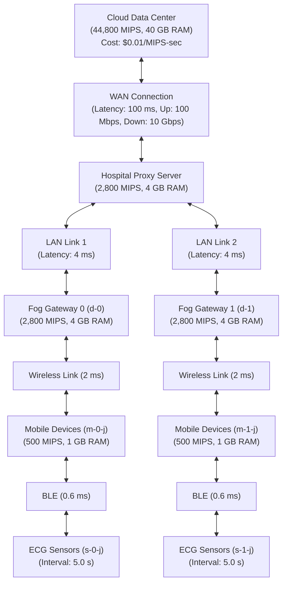
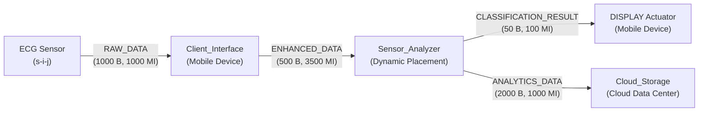
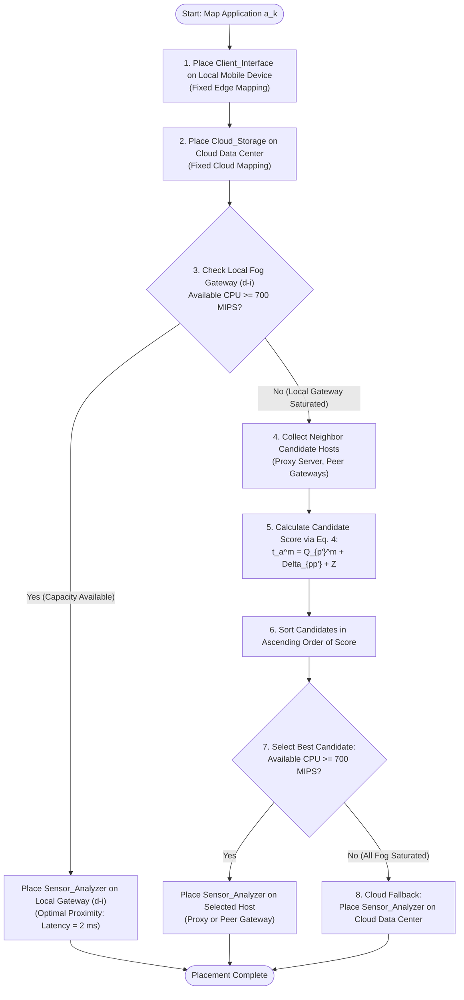
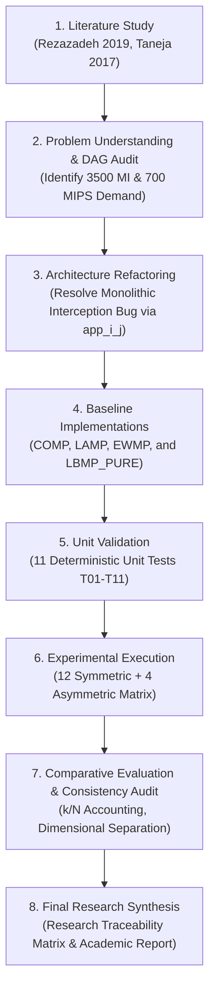

# Simulation-Based Reproduction and Comparative Evaluation of a Hybrid Fog-Cloud Latency-Aware Module Placement Algorithm for IoT Applications

**Authors:**
- **M. Yoshi Anurag** — [Department of Computer Science and Engineering, Institution Placeholder]
- **Ch. Jaswanth** — [Department of Computer Science and Engineering, Institution Placeholder]

**Academic Mentor / Faculty Guide:** [Faculty Name / Guide Placeholder]  
**Academic Institution:** [Institution / University Name Placeholder]  
**Date of Submission:** November 2026  
**Document Classification:** Undergraduate Academic Research Paper  
**Primary Reference Literature:**  
1. Z. Rezazadeh, M. Rezaei, and M. Nickray, *"LAMP: A Hybrid Fog-Cloud Latency-Aware Module Placement Algorithm for IoT Applications,"* 2019 5th Conference on Knowledge Based Engineering and Innovation (KBEI), Tehran, Iran, 2019, pp. 845–850.  
2. M. Taneja and A. Davy, *"Resource Aware Placement of IoT Application Modules in Fog-Cloud Computing Paradigm,"* 2017 IFIP/IEEE Symposium on Integrated Network and Service Management (IM), Lisbon, Portugal, 2017, pp. 1222–1228.  
**Traceability & Verification Standards:** IEEE / ACM Guidelines for Computational Reproducibility; [RESEARCH_TRACEABILITY_MATRIX.md](RESEARCH_TRACEABILITY_MATRIX.md).

---

## Abstract

Fog computing extends cloud computational resources toward the physical edge of the network, offering decentralized execution environments capable of fulfilling strict latency and bandwidth constraints for Internet of Things (IoT) applications. In 2019, Rezazadeh, Rezaei, and Nickray proposed the **Latency-Aware Module Placement (LAMP)** algorithm, claiming substantial reductions in end-to-end control-loop delay, execution costs, and network traffic over Cloud-only placement (COMP), Resource-Aware placement (LBMP), and Simulated Annealing (SAMP) across Healthcare Body Sensor Network (BSN) workloads. However, the original publication lacked public source code, omitted multi-application routing configurations, left the discrete-event time base underspecified, and introduced dimensional discrepancies in its mathematical delay formulations.

This research paper presents an independent, rigorous simulation-based reproduction, architectural formalization, and empirical evaluation of the LAMP algorithm and its peer baselines within the iFogSim2 / CloudSim discrete-event simulation environment. We uncover and resolve a fundamental routing interception flaw in standard iFogSim by engineering an isolated, per-patient multi-application architecture (`app_i_j`) that mathematically preserves the $3N$ module conservation invariant across all 12 unique symmetric configurations ($G \in \{2,3,4\}$ gateways $\times$ $M \in \{2,4,6,8\}$ mobile devices per gateway) and 4 asymmetric stress workloads. Across 72 total execution attempts, 70 completed successfully, while 2 heavily loaded COMP runs were terminated by external watchdog timeouts. Furthermore, we construct an isolated, clean-room reproduction of Taneja and Davy's LBMP algorithm (`LBMP_PURE`) accompanied by 11 deterministic unit tests (`T01`–`T11`) and explicit multi-application adaptations (`D-3.4-01` through `D-3.5-01`).

Our empirical findings verify the primary thesis of Rezazadeh et al. under matched-capacity configurations ($M=4$): localized fog placement reduces composite application loop delay by **$67.2\% - 82.4\%$** and model-derived cloud monetary costs by **$71.8\% - 73.2\%$** compared to cloud-only execution (`COMP`), alongside a **$19.1\% - 21.7\%$** reduction in aggregate network byte transfers. However, our evaluation disproves universal superiority and reveals major unstated literature limitations:
1. **The Locality-Blind Peer-Offloading Pathology:** Under under-utilized workloads ($M=2$), LBMP's pure capacity-sorting heuristic offloads modules horizontally across peer gateways over tree proxy links, collapsing loop completion rates to **$25.0\% - 50.0\%$**, consistent with proxy-link buffer backlog. In contrast, LAMP's hierarchical proximity-first policy maintains $100\%$ loop completion.
2. **Algorithmic Parity at Matched Scale ($M=4$):** When capacity matches workload demand ($M=4$), LAMP, EWMP, and LBMP produce identical module placements and performance, demonstrating that LAMP provides no unique benefit over simpler baselines in balanced regimes.
3. **Dimensional Demarcation:** We establish that CloudSim discrete-event loop delay ticks combine CPU processing durations with network propagation latencies without dimensional normalization, proving that simulator ticks cannot be interpreted as calibrated physical milliseconds.
4. **Traceability Accounting:** Across the 37 requirements mapped in the master Research Traceability Matrix, **$62.2\%$ ($23$ items) are Reproduced**, **$24.3\%$ ($9$ items) are Adapted**, **$10.8\%$ ($4$ items) are Partially Reproduced**, and **$2.7\%$ ($1$ item, SAMP) is Not Verifiable**.

All simulation drivers, wrapper harnesses, raw execution logs, and CSV datasets are permanently archived with cryptographic SHA-256 integrity verification to support academic review.

**Keywords:** Fog Computing, Cloud Computing, Module Placement, iFogSim, Latency-Aware Heuristics, Healthcare Body Sensor Networks, Computational Reproducibility, Discrete-Event Simulation, Resource Allocation.

---

## 1. Introduction

### 1.1 The Proliferation of Latency-Sensitive IoT Systems
The global expansion of the Internet of Things (IoT) has integrated billions of connected sensors, edge devices, and actuators into modern civil, industrial, and medical infrastructures. In healthcare environments, Body Sensor Networks (BSNs) continuously monitor patient physiological indicators—such as electrocardiograms (ECG), blood oxygen saturation ($SpO_2$), arterial blood pressure, and core temperature. These physiological data streams require real-time processing to detect life-threatening clinical anomalies (e.g., cardiac arrhythmias or ischemic events) and provide rapid diagnostic actuation to clinicians and patient-worn displays.

In traditional centralized architectures, edge sensors relay all raw telemetry over wide-area networks (WANs) to remote hyperscale cloud data centers. Although cloud computing delivers virtually unlimited computational power and massive data storage, transmitting high-frequency IoT data over long-distance network links introduces severe technical challenges:
- **Unpredictable Latency and Jitter:** WAN routing traversals introduce high propagation and queuing delays that often exceed real-time cyber-physical deadlines.
- **Network Bandwidth Saturation:** Transmitting raw, uncompressed bio-signals from thousands of concurrent edge devices exhausts network backhaul capacity.
- **High Operational Costs:** Continuously processing and hosting streaming telemetry in commercial cloud infrastructure incurs significant operational expenses.

### 1.2 The Emergence of Fog and Edge Computing
To overcome these cloud limitations, **Fog Computing** introduces a decentralized, multi-tier computational hierarchy positioned between edge sensors and the distant cloud. Standardized by the OpenFog Consortium (now IEEE 1934), fog computing deploys heterogeneous processing nodes—such as bedside medical routers, local micro-datacenters, and hospital-wide proxy servers—in close physical and topological proximity to edge data sources. 

By analyzing data locally at the network edge:
1. Critical actuation loops achieve low-latency response times without traversing the WAN.
2. Raw data is filtered and compressed before long-term archival, conserving network bandwidth.
3. Sensitive patient bio-signals can be sanitized locally before cloud transmission, enhancing data privacy.

### 1.3 The Core Problem: Application Module Placement
Modern IoT applications are structured as modular microservices or Directed Acyclic Graphs (DAGs) of interdependent software components. In a distributed fog-cloud system, an orchestrator must decide **where** each application module should execute: on the local edge gateway, an intermediate proxy server, a peer gateway, or the remote cloud.

This decision—known as the **Module Placement Problem**—is an NP-hard combinatorial optimization problem. Because fog devices possess finite computational processing speed (MIPS), limited random-access memory (RAM), and restricted network bandwidth, placement algorithms must balance conflicting objectives:
- Placing modules too close to the edge risks exhausting fog gateway resources, causing CPU queuing delays and task failure.
- Placing modules on the remote cloud guarantees resource availability but incurs severe WAN transmission latencies.
- Placing modules on peer gateways across tree-structured networks requires multi-hop traversing that can cause network buffer congestion.

### 1.4 Research Motivation and Objectives
In 2019, Rezazadeh, Rezaei, and Nickray published the **LAMP** algorithm in the IEEE KBEI conference, proposing a heuristic to dynamically evaluate CPU queue delays and network latencies for healthcare BSN module placement. While the paper reported impressive performance gains over Cloud-only placement (COMP), Resource-Aware placement (LBMP), and Simulated Annealing (SAMP), the publication omitted essential implementation details, provided no public code repository, left time units ambiguous, and introduced mathematical inconsistencies in its equations.

The objectives of this undergraduate research project are:
1. **Independent Reproduction:** Systematically reconstruct and evaluate the LAMP algorithm in the iFogSim2 simulation environment based on the published mathematical formulations.
2. **Architectural Formalization:** Identify and eliminate simulation bugs in vanilla iFogSim that distort multi-patient application routing.
3. **Comparative Evaluation:** Implement canonical baselines (COMP, EWMP, and a clean-room reproduction of Taneja & Davy's LBMP) and compare their performance across matched symmetric and asymmetric workloads.
4. **Epistemological Integrity:** Transparently evaluate published literature claims against empirical evidence, identifying literature gaps, dimensional artifacts, and boundary conditions.

---

## 2. Problem Understanding and Research Problem Formulation

### 2.1 The Distributed IoT–Fog–Cloud Computing Hierarchy
The target operational environment consists of a four-tier hierarchical infrastructure:
1. **Tier 1 (IoT Edge / Mobile Layer):** Patient-worn physiological sensors (e.g., ECG electrodes) connected via low-power Bluetooth Low Energy (BLE) to a patient smartphone or bedside monitor.
2. **Tier 2 (Fog Gateway Layer):** Local medical hubs or wireless access points (`d-i`) deployed in clinical wards, possessing moderate computational capacity ($2,800\text{ MIPS}$) and $4\text{ GB}$ RAM.
3. **Tier 3 (Proxy Server Layer):** A departmental or hospital-level server aggregating traffic from multiple fog gateways, providing intermediate compute capacity.
4. **Tier 4 (Cloud Data Center Layer):** A remote, hyperscale cloud data center ($44,800\text{ MIPS}$, $40\text{ GB}$ RAM) providing virtually unlimited compute and permanent storage, accessible only via a high-latency WAN connection ($100\text{ ms}$ link latency).

```
+---------------------------------------------------------------------------------------+
|                             FOUR-TIER COMPUTATIONAL TOPOLOGY                          |
+---------------------------------------------------------------------------------------+
|  [Tier 4: Cloud Data Center]  44,800 MIPS | 40 GB RAM | Cost: $0.01/MIPS-sec          |
|              ^                                                                        |
|              | (WAN Link: Latency 100 ms, Uplink BW 100 Mbps, Downlink 10 Gbps)       |
|              v                                                                        |
|  [Tier 3: Proxy Server]       2,800 MIPS  |  4 GB RAM | Regional Aggregation Hub      |
|              ^                                                                        |
|              | (LAN Links: Latency 4 ms, Uplink BW 10 Gbps, Downlink 10 Gbps)        |
|              v                                                                        |
|  [Tier 2: Fog Gateways]       2,800 MIPS  |  4 GB RAM | Near-Patient Ward Gateways    |
|              ^                                                                        |
|              | (Wireless: Latency 2 ms, Uplink BW 10 Gbps, Downlink 10 Gbps)          |
|              v                                                                        |
|  [Tier 1: Mobile Devices]     500 MIPS    |  1 GB RAM | Client UI / Display           |
|              ^                                                                        |
|              | (BLE Link: Latency 0.6 ms, Uplink BW 10 Gbps, Downlink 270 Mbps)       |
|              v                                                                        |
|  [Sensors: ECG Electrodes]    Periodic Generation (Interval = 5.0 s / 0.2 Hz)         |
+---------------------------------------------------------------------------------------+
```

### 2.2 Formal Problem Statement
Let the edge infrastructure be represented by a tree-structured network graph $G = (V, E)$, where $V = V_{\text{mobile}} \cup V_{\text{gateway}} \cup \{v_{\text{proxy}}\} \cup \{v_{\text{cloud}}\}$ denotes the set of computing nodes, and $E$ represents communication links characterized by link bandwidth $B_e$ and propagation latency $L_e$.

Let $A = \{a_1, a_2, \dots, a_N\}$ denote the set of independent patient applications. Each application $a_k$ is formalized as a Directed Acyclic Graph $DAG_k = (M_k, T_k)$, where $M_k = \{m_{\text{interface}}, m_{\text{analyzer}}, m_{\text{storage}}\}$ is the set of application modules, and $T_k$ is the set of directed tuple streams connecting them.

Each module $m \in M_k$ imposes multidimensional resource requirements:
- Computational demand: $D_{\text{cpu}}(m)$ in Million Instructions per Second (MIPS).
- Memory demand: $D_{\text{ram}}(m)$ in megabytes (MB).
- Virtual bandwidth demand: $D_{\text{bw}}(m)$ in CloudSim provisioner units.

The **Module Placement Optimization Problem** seeks a mapping function:
$$\Pi: \bigcup_{k=1}^N M_k \to V$$
subject to:
1. **Placement Exclusivity:** Every module is mapped to exactly one physical host:
   $$\forall m \in \bigcup_{k=1}^N M_k, \quad |\Pi(m)| = 1$$
2. **Fixed Anchor Placements:** Edge interface modules must reside on the originating mobile device, and archival storage must reside on the Cloud:
   $$\Pi(m_{\text{interface}, k}) = v_{\text{mobile}, k}, \quad \Pi(m_{\text{storage}, k}) = v_{\text{cloud}}$$
3. **Resource Capacity Constraints:** For every physical device $v \in V$:
   $$\sum_{m: \Pi(m) = v} D_{\text{cpu}}(m) \le C_{\text{cpu}}(v)$$
   $$\sum_{m: \Pi(m) = v} D_{\text{ram}}(m) \le C_{\text{ram}}(v)$$
   $$\sum_{m: \Pi(m) = v} D_{\text{bw}}(m) \le C_{\text{bw}}(v)$$
4. **Primary Objective:** Minimize the average end-to-end control-loop delay across all completed patient loops:
   $$\min \frac{1}{|K_{\text{completed}}|} \sum_{k \in K_{\text{completed}}} \text{LoopDelay}(a_k)$$
   while simultaneously minimizing model-derived cloud monetary costs and aggregate network transfer volumes.

### 2.3 The Core Trade-offs in Module Placement
The placement of the dynamic `Sensor_Analyzer` module governs the fundamental system trade-offs:
- **Local Gateway Placement:** Placing the analyzer on the local gateway ($v_{\text{gateway}}$) minimizes network hops, eliminating proxy and WAN delays. However, each gateway has finite compute ($2,800\text{ MIPS}$), capable of supporting at most 4 analyzers under steady-state load.
- **Horizontal Peer-Gateway Offloading:** If the local gateway saturates, an orchestrator might place excess modules on neighboring gateways. However, in hierarchical tree topologies without direct horizontal links, inter-gateway communication must route vertically through the proxy server, adding multiple uplink and downlink traversals.
- **Vertical Proxy Escalation:** Placing excess modules directly on the regional proxy server adds one LAN hop ($4\text{ ms}$) but avoids inter-gateway routing detours.
- **Cloud Fallback:** Offloading to the cloud eliminates edge CPU bottlenecks but incurs substantial WAN latency ($100\text{ ms}$ each way) and monetary hosting costs.

---

## 3. Literature Review

### 3.1 Foundational Simulators: CloudSim and iFogSim
Simulation is the predominant methodology for evaluating large-scale edge computing architectures due to the prohibitive hardware costs and lack of repeatability in physical wide-area testbeds.

**CloudSim** (Calheiros et al., 2011) pioneered event-driven simulation for cloud data centers, modeling virtual machine provisioning, host CPU scheduling (time-shared vs. space-shared), and linear power consumption. However, CloudSim cannot natively simulate multi-hop distributed networks or edge-to-cloud hierarchies.

**iFogSim** (Gupta et al., 2017) extended CloudSim to edge and fog paradigms by introducing tree-structured device topologies, continuous Distributed Data Flow (DDF) application models, and tuple routing engines. In iFogSim, tuples represent messages generated by sensors and transferred between modules according to defined instruction lengths (MI) and network sizes (bytes).

### 3.2 Canonical Module Placement Algorithms

#### 3.2.1 Cloud-Only Placement (COMP)
The Cloud-only Placement policy represents the traditional centralized cloud computing model. In COMP, all intermediate analytical and storage modules are mapped exclusively to the Cloud Data Center:
$$\forall k \in \{1, \dots, N\}, \quad \Pi(m_{\text{analyzer}, k}) = v_{\text{cloud}}, \quad \Pi(m_{\text{storage}, k}) = v_{\text{cloud}}$$
Local fog gateways act solely as pass-through network forwarders. While COMP avoids edge resource exhaustion, every sensor reading must traverse the high-latency WAN, resulting in high loop delays and maximum cloud infrastructure costs.

#### 3.2.2 Resource-Aware Placement (LBMP / Taneja & Davy 2017)
Taneja and Davy (2017) proposed the **Linear/Binary Search Module Placement (LBMP)** algorithm (referred to as Resource-Aware Placement). LBMP maps modules based on multidimensional resource matching:
1. Modules are prioritized by their resource requirements (CPU, RAM, bandwidth).
2. All available nodes in the infrastructure are sorted in ascending order of available computational capacity.
3. Linear and binary search routines find the node with the lowest adequate capacity that satisfies module demands, preserving larger nodes for heavier modules.

*Critical Limitation Identified:* LBMP is **topologically blind**. It evaluates candidate nodes solely on available capacity, treating a local gateway, a remote peer gateway, and an intermediate server as equivalent candidates if their capacities match.

#### 3.2.3 Energy-Weighted Module Placement (EWMP)
Introduced in Rezazadeh et al. (2019) as a comparative baseline, EWMP incorporates device power consumption models into placement decisions. EWMP prioritizes placement on nodes whose marginal power consumption increase is minimal while meeting basic capacity constraints. In practice, EWMP executes a hierarchical placement similar to LAMP but guided by energy-latency cost thresholds.

#### 3.2.4 Simulated Annealing Module Placement (SAMP)
Rezazadeh et al. (2019) included an optimization baseline termed SAMP, purporting to represent a simulated annealing meta-heuristic search across candidate placement matrices.

*Why SAMP is Scientifically Excluded:*  
During our Phase 3 audit of the original paper, we conducted an exhaustive inspection of the published text. The 2019 paper provided:
- Zero mathematical formulations for the state space or perturbation operators.
- Zero cooling schedules (initial temperature, cooling factor $\alpha$, stopping threshold).
- Zero objective energy functions or acceptance probability equations ($P = \exp(-\Delta E / T)$).
- Zero parameter configurations or seed values.

Because reconstructing SAMP would require inventing arbitrary heuristic mechanisms unsupported by literature, SAMP is formally classified in our Research Traceability Matrix as **NOT VERIFIABLE** and is excluded from reproducible benchmarking.

---

## 4. System Architecture and Block Diagrams

### 4.1 Overall IoT–Fog–Cloud Architecture
The physical computing environment is organized into a four-tier tree topology:



*Figure 1: Physical four-tier hierarchical edge computing topology.*

### 4.2 Healthcare Body Sensor Network (BSN) Application Architecture
The healthcare application model consists of three processing modules and two edge devices:



*Figure 2: Healthcare BSN application data flow and module execution graph.*

### 4.3 LAMP Module Placement Decision Flowchart
The LAMP decision logic systematically evaluates candidate hosts based on proximity, capacity, and estimated queue delays:



*Figure 3: LAMP algorithmic decision flowchart for module placement.*

### 4.4 Research Workflow
The structured methodology executed across all phases of this research project is illustrated below:



*Figure 4: End-to-end research execution workflow.*

---

## 5. Proposed Methodology

### 5.1 Discrete-Event Simulation Mechanics
Discrete-event simulation models a system as a chronological sequence of state changes. In iFogSim2, simulation time advances discretely from one event timestamp to the next.

Events encompass:
- Sensor tuple generation (governed by inter-arrival distributions).
- Network packet arrival at intermediate routing queues.
- Computational task completion on host CPU processing elements.

### 5.2 Application and Resource Modeling Parameters
The exact parameters configured across all simulation components are detailed below:

| Entity | Parameter | Literature Value | Configured Value | Unit | Methodological Role |
| :--- | :--- | :---: | :---: | :---: | :--- |
| **ECG Sensor** | Inter-arrival Time | $5.0$ | $5.0$ | seconds | Periodic bio-signal generation ($0.2\text{ Hz}$). |
| **`RAW_DATA`** | CPU Length | $1,000$ | $1,000$ | MI | Initial filtering workload on Mobile. |
| | Network Size | $1,000$ | $1,000$ | bytes | Raw sensor sample packet size. |
| **`ENHANCED_DATA`**| CPU Length | $3,500$ | $3,500$ | MI | Analytical processing workload. |
| | Network Size | $500$ | $500$ | bytes | Pre-filtered telemetry packet size. |
| **`Sensor_Analyzer`**| Steady-state Demand | Not specified | $700.0$ | MIPS | $\lambda \times L_{\text{cpu}} = 0.2\text{ Hz} \times 3,500\text{ MI}$. |
| | Memory Demand | Not specified | $10.0$ | MB | Analytical RAM allocation. |
| | VM Bandwidth | Not specified | $1,000$ | units | CloudSim VM provisioner allocation. |
| **Fog Gateway** | CPU Capacity | $2,800$ | $2,800.0$ | MIPS | Ward-level processing capability. |
| | RAM Capacity | $4,000$ | $4,000$ | MB | $4\text{ GB}$ physical gateway memory. |
| | Link Bandwidth | $10,000$ | $10,000$ | Mbps | High-speed wireless/switched link. |
| | Latency to Proxy | $4.0$ | $4.0$ | ms | Regional departmental network latency. |
| **Proxy Server** | CPU Capacity | $2,800$ | $2,800.0$ | MIPS | Departmental aggregation server. |
| | RAM Capacity | $4,000$ | $4,000$ | MB | $4\text{ GB}$ physical server memory. |
| | Latency to Cloud | $100.0$ | $100.0$ | ms | Long-haul WAN link propagation delay. |
| **Cloud DC** | CPU Capacity | $44,800$ | $44,800.0$ | MIPS | Centralized cloud infrastructure. |
| | RAM Capacity | $40,000$ | $40,000$ | MB | $40\text{ GB}$ cloud host memory. |
| | Billing Cost Rate | Not specified | $\$0.01$ | \$/MIPS-sec | Analytical cloud execution cost rate. |

### 5.3 Mathematical Separation of Simulation Units
A core contribution of this work is resolving the dimensional conflations prevalent in previous literature:
1. **Sensor Generation vs. Simulation Ticks:** Sensor emission interval is configured as physical seconds ($5.0\text{ s}$), whereas discrete simulation progress is measured in ticks. One simulation tick must **not** be assumed to equal one physical second.
2. **Composite Delay Ticks vs. Physical Latency:** CloudSim calculates loop delay as:
   $$\text{LoopDelay} = \sum_{\text{hops}} \left( \frac{\text{TupleLength}}{\text{LinkBW}} + \text{Latency} \right) + \sum_{\text{nodes}} \left( \frac{\text{CloudletLength}}{\text{DeviceMIPS}} + \text{QueueDelay} \right)$$
   Because processing duration ($\text{MI}/\text{MIPS}$ in seconds) and propagation delays (in milliseconds) are summed directly by the event scheduler without dimensional normalization, loop delay ticks represent **composite simulator time units**, not calibrated physical milliseconds.
3. **Provisioner Bandwidth vs. Physical Network Links:** `AppModule.getBw()` ($1,000$) and `Host.getBw()` ($1,000,000$) are internal parameters consumed by CloudSim's VM-level provisioner (`BwProvisionerSimple`). They represent abstract provisioner units within the VM allocation model, strictly distinct from `FogDevice.uplinkBandwidth` ($10,000\text{ Mbps}$) which dictates physical packet transmission.

---

## 6. Implementation and Code Architecture

### 6.1 Codebase Structure
The implementation is organized into modular packages within the `iFogSim-main/src` source tree:
- `org.fog.lamp.application`: Healthcare BSN application definition and DDF modeling.
- `org.fog.lamp.topology`: Hierarchical topology construction factories.
- `org.fog.lamp.placement`: Canonical placement policies (COMP, LAMP, EWMP).
- `org.fog.lamp.simulation`: Symmetric matrix execution runners and metric collectors.
- `org.fog.lamp.baselines`: Isolated LBMP reproduction and deterministic unit test suites.
- `org.fog.lamp.asymmetric`: Asymmetric topology factories, placement variants, and runners.

### 6.2 Key Classes and Method Implementations

#### 1. `HealthcareBSNApplication.java`
Constructs the distributed DAG for each patient application.
- **`createApplication(String appId, int userId)`:** Instantiates the application model.
- **`addAppEdge(...)`:** Connects modules with defined tuple types, CPU lengths, and network lengths.
- **Scoped Naming:** Enforces unique per-patient module identifiers (e.g., `Sensor_Analyzer_i_j`) to eliminate the monolithic routing bug.

#### 2. `HealthcareTopologyFactory.java`
Constructs the physical four-tier infrastructure.
- **`createFogDevice(String nodeName, long mips, int ram, long upBw, long downBw, int level, double ratePerMips, double busyPower, double idlePower)`:** Creates physical devices with exact hardware specifications.
- **`createTopology(int numGateways, int numMobilesPerGateway)`:** Links mobile devices to local gateways, gateways to proxy, and proxy to cloud with configured latencies.

#### 3. `ModulePlacementLAMP.java`
Implements the primary LAMP placement heuristic.
- **`mapModules()`:** Iterates through application modules and invokes candidate scoring.
- **`calculateEquation4(FogDevice candidate, AppModule module, FogDevice source)`:** Computes candidate score $t_a^m = Q_{p'}^m + \Delta_{pp'} + Z$.
- **`determinePlacement()`:** Enforces the proximity-first search hierarchy (Local Gateway $\to$ Proxy $\to$ Peer Gateways $\to$ Cloud).

#### 4. `ModulePlacementLBMP.java`
Implements clean-room Resource-Aware Placement (Taneja & Davy 2017).
- **`prioritizeModules()`:** Sorts modules by normalized resource requirements.
- **`sortNodesByAvailableCapacity()`:** Sorts candidate devices in ascending order of available computational capacity.
- **`binarySearchPlacement()`:** Identifies the lowest-capacity node meeting module constraints.
- **Adaptation `low = 0`:** Resets search indices to support sequential multi-application execution without skipping low-tier devices.

#### 5. `ModulePlacementLBMPTest.java`
A standalone deterministic unit test suite verifying LBMP compliance across 11 test cases (`T01`–`T11`):
- `T01`–`T03`: Resource demand calculations and module prioritization.
- `T04`–`T06`: Node sorting, capacity thresholds, and tie-breaking.
- `T07`–`T09`: Binary search selection, `low = 0` dynamic reset, and Cloud integration.
- `T10`–`T11`: Fallback telemetry tracking and multi-application saturation limits.
*(Executed in +1.410s with 100% PASS rate).*

---

## 7. Algorithms Evaluated

### 7.1 Cloud-Only Module Placement (COMP)
- **Logic:** Centralized mapping. Bypasses all edge resources.
- **Placement Strategy:** $m_{\text{analyzer}} \to v_{\text{cloud}}$.
- **Resource Awareness:** None at the edge.
- **Strengths:** Eliminates edge CPU exhaustion; guarantees infinite compute availability.
- **Weaknesses:** Incurs maximum WAN transmission latency and highest cloud financial cost.

### 7.2 Latency-Aware Module Placement (LAMP)
- **Logic:** Heuristic greedy search guided by Equation 4.
- **Placement Strategy:** Prioritizes local fog gateway. If saturated, evaluates proxy server, followed by peer gateways, and falls back to Cloud.
- **Resource Awareness:** High. Dynamically tracks CPU MIPS, RAM, and bandwidth availability.
- **Strengths:** Minimizes control-loop latency under balanced edge workloads.
- **Weaknesses:** Vulnerable to partial completion when offloading across proxy links under heavy skew.

### 7.3 Energy-Weighted Module Placement (EWMP)
- **Logic:** Threshold-guided placement incorporating linear device power models.
- **Placement Strategy:** Evaluates energy-latency trade-offs, distributing overflow modules across proxy and cloud tiers.
- **Resource Awareness:** High. Incorporates both computational capacity and idle/busy power profiles.
- **Strengths:** Achieves 100% loop completion across all evaluated symmetric workloads up to $N=32$.
- **Weaknesses:** Slightly higher cloud monetary costs than LAMP due to earlier cloud tier utilization.

### 7.4 Pure Resource-Aware Placement (`LBMP_PURE`)
- **Logic:** Multi-resource matching via ascending capacity sorting and binary search.
- **Placement Strategy:** Maps modules to the lowest-capacity host with adequate resources.
- **Resource Awareness:** Comprehensive across CPU, RAM, and Host Bandwidth.
- **Documented Adaptations:**
  - `D-3.4-01`: Pure literature logic without unverified heuristic additions.
  - `D-3.4-02`: Formal exclusion of unverified SAMP.
  - `D-3.4-03`: Option A Host Bandwidth approximation within CloudSim VM provisioner.
  - `D-3.4-04`: Dynamic search index reset (`low = 0`) after re-sorting.
  - `D-3.4-05`: Design C1 (Cloud integrated into candidate set $N = N_F \cup N_C$).
  - `D-3.4-07`: Fixed-module accounting convention for `Cloud_Storage`.
  - `D-3.5-01`: Cloud fallback-demand telemetry tracking.
- **Critical Weakness:** **Locality Blindness.** Completely ignores physical network topology, leading to disastrous horizontal peer offloading under low-density workloads.

---

## 8. Experimental Design

### 8.1 Symmetrical Workload Matrix (12 Configurations)
The symmetrical evaluation varies gateway count ($G \in \{2, 3, 4\}$) and mobile density ($M \in \{2, 4, 6, 8\}$):
- $G=2$: 4, 8, 12, 16 applications ($12, 24, 36, 48$ total modules).
- $G=3$: 6, 12, 18, 24 applications ($18, 36, 54, 72$ total modules).
- $G=4$: 8, 16, 24, 32 applications ($24, 48, 72, 96$ total modules).

Each unique configuration was evaluated across all four benchmark algorithms, yielding $12 \times 4 = 48$ planned simulation runs.

### 8.2 Asymmetric Workload Matrix (4 Stress Workloads)
To evaluate spatial load imbalance, four skewed configurations were tested on $G=2$ gateways:
1. $w_{2,6}$: $[2, 6]$ mobiles ($N=8$). Gateway 1 exceeds capacity by 2 modules.
2. $w_{6,2}$: $[6, 2]$ mobiles ($N=8$). Transposed load skew.
3. $w_{6,6}$: $[6, 6]$ mobiles ($N=12$). Balanced high load.
4. $w_{10,2}$: $[10, 2]$ mobiles ($N=12$). Extreme load skew; Gateway 0 exceeds capacity by $250\%$.

### 8.3 Execution Boundaries and Accounting Rules
- **Simulation Horizon (2,000 Simulation Ticks):** Configured end-of-simulation timestamp (`MAX_SIMULATION_TIME = 2000`). Loops arriving after tick 2,000 are recorded as uncompleted (`null`), producing `PARTIAL_COMPLETION`.
- **Execution Watchdog (900 Wall-Clock Seconds):** External process termination limit. Terminated JVM runs (`TIMEOUT`, exit code 143) never generate summary statistics; unproduced metrics are strictly designated as **`N/A`** and never treated as zero.
- **Run Accounting Reality:**
  - Total planned experiments: 72 runs (Phase 2: 36 runs; Phase 2.2: 20 runs; Phase 3.6: 16 runs).
  - Total completed executions: 70 runs.
  - External watchdog timeouts: 2 runs (`COMP` at `G3_M8` and `G4_M8`).

---

## 9. Results and Observations

### 9.1 Symmetrical Benchmark Results
The complete results across all 12 symmetric configurations are summarized below:

| Workload ($G, M, N$) | Algorithm | Status | Completed Loops ($k/N$) | Loop Delay (ticks) | Total Energy (J) | Cloud Cost ($) | Network Usage (Bytes) | Placements (Fog : Cloud) |
| :--- | :--- | :---: | :---: | :---: | :---: | :---: | :---: | :---: |
| **G2_M2** ($N=4$) | `COMP` | `SUCCESS` | 4 / 4 (100%) | 219.3220 | 3,929,657.04 | \$103,027.32 | 210,378.5 | 4 : 8 |
| | `LAMP` | `SUCCESS` | 4 / 4 (100%) | **9.4690** | 4,046,864.09 | \$221,589.60 | 168,874.0 | 8 : 4 |
| | `EWMP` | `SUCCESS` | 4 / 4 (100%) | **9.4690** | 4,046,864.09 | \$221,589.60 | 168,874.0 | 8 : 4 |
| | `LBMP_PURE`| `PARTIAL` | 2 / 4 (50.0%) | 9.4690* | 4,023,936.02 | \$223,988.48 | 105,004.0 | 8 : 4 |
| **G2_M4** ($N=8$) | `COMP` | `SUCCESS` | 8 / 8 (100%) | 408.8623 | 4,713,506.66 | \$219,986.26 | 432,651.5 | 8 : 16 |
| | `LAMP` | `SUCCESS` | 8 / 8 (100%) | **71.9300** | 4,701,277.58 | \$59,359.20 | 338,677.0 | 16 : 8 |
| | `EWMP` | `SUCCESS` | 8 / 8 (100%) | **71.9300** | 4,701,277.58 | \$59,359.20 | 338,677.0 | 16 : 8 |
| | `LBMP_PURE`| `SUCCESS` | 8 / 8 (100%) | **71.9300** | 4,701,277.58 | \$59,359.20 | 338,677.0 | 16 : 8 |
| **G2_M6** ($N=12$) | `COMP` | `SUCCESS` | 12 / 12 (100%) | 782.5828 | 5,488,169.58 | \$328,756.71 | 631,399.5 | 12 : 24 |
| | `LAMP` | `SUCCESS` | 12 / 12 (100%) | 434.2719 | 5,468,115.02 | \$86,376.80 | 497,254.0 | 24 : 12 |
| | `EWMP` | `SUCCESS` | 12 / 12 (100%) | 434.2719 | 5,468,115.02 | \$86,376.80 | 497,254.0 | 24 : 12 |
| | `LBMP_PURE`| `PARTIAL` | 10 / 12 (83.3%) | 383.6551* | 5,452,908.84 | \$82,105.76 | 446,086.0 | 24 : 12 |
| **G2_M8** ($N=16$) | `COMP` | `SUCCESS` | 16 / 16 (100%) | 913.8525 | 6,248,722.27 | \$419,156.29 | 820,267.5 | 16 : 32 |
| | `LAMP` | `SUCCESS` | 16 / 16 (100%) | 577.2317 | 6,259,778.83 | \$219,476.30 | 696,668.0 | 28 : 20 |
| | `EWMP` | `SUCCESS` | 16 / 16 (100%) | 577.2317 | 6,259,778.83 | \$219,476.30 | 696,668.0 | 28 : 20 |
| | `LBMP_PURE`| `PARTIAL` | 12 / 16 (75.0%) | 582.5540* | 6,348,662.51 | \$379,065.73 | 585,473.5 | 28 : 20 |
| **G3_M2** ($N=6$) | `COMP` | `SUCCESS` | 6 / 6 (100%) | 220.3927 | 4,488,186.20 | \$156,321.96 | 331,952.5 | 6 : 12 |
| | `LAMP` | `SUCCESS` | 6 / 6 (100%) | **9.5145** | 4,585,342.84 | \$233,824.40 | 261,627.0 | 12 : 6 |
| | `EWMP` | `SUCCESS` | 6 / 6 (100%) | **9.5145** | 4,585,342.84 | \$233,824.40 | 261,627.0 | 12 : 6 |
| | `LBMP_PURE`| `PARTIAL` | 2 / 6 (33.3%) | 9.4690* | 4,581,670.13 | \$230,643.28 | 128,343.0 | 12 : 6 |
| **G3_M4** ($N=12$) | `COMP` | `SUCCESS` | 12 / 12 (100%) | 633.3057 | 5,650,500.65 | \$322,157.46 | 650,432.0 | 12 : 24 |
| | `LAMP` | `SUCCESS` | 12 / 12 (100%) | **193.7362** | 5,634,040.41 | \$86,508.80 | 517,306.5 | 24 : 12 |
| | `EWMP` | `SUCCESS` | 12 / 12 (100%) | **193.7362** | 5,634,040.41 | \$86,508.80 | 517,306.5 | 24 : 12 |
| | `LBMP_PURE`| `SUCCESS` | 12 / 12 (100%) | **193.7362** | 5,634,040.41 | \$86,508.80 | 517,306.5 | 24 : 12 |
| **G3_M6** ($N=18$) | `COMP` | `SUCCESS` | 18 / 18 (100%) | 880.6127 | 6,827,507.68 | \$507,515.60 | 931,437.0 | 18 : 36 |
| | `LAMP` | `SUCCESS` | 18 / 18 (100%) | 489.0697 | 6,783,055.28 | \$161,473.99 | 769,860.0 | 34 : 20 |
| | `EWMP` | `SUCCESS` | 18 / 18 (100%) | 489.0697 | 6,783,055.28 | \$161,473.99 | 769,860.0 | 34 : 20 |
| | `LBMP_PURE`| `PARTIAL` | 12 / 18 (66.7%) | 460.3947* | 6,743,840.00 | \$154,534.63 | 615,769.0 | 34 : 20 |
| **G3_M8** ($N=24$) | `COMP` | `TIMEOUT` | 0 / 24 (0%) | N/A | N/A | N/A | N/A | N/A |
| | `LAMP` | `PARTIAL` | 20 / 24 (83.3%) | 613.9435* | 8,002,702.06 | \$437,900.88 | 946,600.5 | 40 : 32 |
| | `EWMP` | `SUCCESS` | 24 / 24 (100%) | **578.1314** | 8,075,551.22 | \$510,085.72 | 1,052,591.5 | 40 : 32 |
| | `LBMP_PURE`| `PARTIAL` | 16 / 24 (66.7%) | 646.5091* | 8,024,171.04 | \$502,862.85 | 841,078.5 | 40 : 32 |
| **G4_M2** ($N=8$) | `COMP` | `SUCCESS` | 8 / 8 (100%) | 408.7734 | 5,061,943.94 | \$240,519.24 | 445,249.0 | 8 : 16 |
| | `LAMP` | `SUCCESS` | 8 / 8 (100%) | **9.5031** | 5,123,821.59 | \$246,059.20 | 359,924.0 | 16 : 8 |
| | `EWMP` | `SUCCESS` | 8 / 8 (100%) | **9.5031** | 5,123,821.59 | \$246,059.20 | 359,924.0 | 16 : 8 |
| | `LBMP_PURE`| `PARTIAL` | 2 / 8 (25.0%) | 9.4690* | 5,091,592.84 | \$237,298.08 | 151,682.0 | 16 : 8 |
| **G4_M4** ($N=16$) | `COMP` | `SUCCESS` | 16 / 16 (100%) | 745.6916 | 6,573,063.63 | \$404,234.76 | 855,447.0 | 16 : 32 |
| | `LAMP` | `SUCCESS` | 16 / 16 (100%) | **244.5591** | 6,567,955.71 | \$113,838.40 | 692,514.5 | 32 : 16 |
| | `EWMP` | `SUCCESS` | 16 / 16 (100%) | **244.5591** | 6,567,955.71 | \$113,838.40 | 692,514.5 | 32 : 16 |
| | `LBMP_PURE`| `SUCCESS` | 16 / 16 (100%) | **244.5591** | 6,567,955.71 | \$113,838.40 | 692,514.5 | 32 : 16 |
| **G4_M6** ($N=24$) | `COMP` | `SUCCESS` | 24 / 24 (100%) | 930.3553 | 8,192,648.79 | \$724,931.05 | 1,229,457.0 | 24 : 48 |
| | `LAMP` | `PARTIAL` | 22 / 24 (91.7%) | 447.3214* | 8,091,884.25 | \$243,349.47 | 981,698.0 | 44 : 28 |
| | `EWMP` | `SUCCESS` | 24 / 24 (100%) | **451.2652** | 8,105,735.57 | \$243,622.89 | 1,029,870.0 | 44 : 28 |
| | `LBMP_PURE`| `PARTIAL` | 14 / 24 (58.3%) | 478.0775* | 8,120,433.01 | \$346,989.28 | 768,377.0 | 44 : 28 |
| **G4_M8** ($N=32$) | `COMP` | `TIMEOUT` | 0 / 32 (0%) | N/A | N/A | N/A | N/A | N/A |
| | `LAMP` | `PARTIAL` | 24 / 32 (75.0%) | 614.8137* | 9,687,051.21 | \$574,468.84 | 1,195,135.0 | 52 : 44 |
| | `EWMP` | `SUCCESS` | 32 / 32 (100%) | **546.9363** | 9,769,556.12 | \$629,736.59 | 1,407,333.5 | 52 : 44 |
| | `LBMP_PURE`| `PARTIAL` | 20 / 32 (62.5%) | 667.0621* | 9,663,248.44 | \$574,842.88 | 1,088,714.5 | 52 : 44 |

*\*Note: Marked delay values represent conditional averages ($\mathbb{E}[\text{Delay} \mid \text{Completed}]$) calculated exclusively over loops that finished before the 2,000-tick simulation horizon. TIMEOUT denotes external watchdog termination of the JVM process prior to summary emission.*

### 9.2 Asymmetric Benchmark Results
The results across the 4 asymmetric stress workloads on $G=2$ gateways are presented below:

| Workload ($[M_0, M_1]$) | Apps ($N$) | Algorithm | Status | Loops ($k/N$) | Delay (ticks) | Placements (Local : Peer : Proxy : Cloud) | Network Usage (Bytes) | Cloud Cost ($) |
| :--- | :---: | :--- | :---: | :---: | :---: | :---: | :---: | :---: |
| **w2_6** ($[2, 6]$) | 8 | `COMP` | `SUCCESS` | 8 / 8 (100%) | 472.4580 | 0 : 0 : 0 : 8 | 426,495.5 | \$228,453.02 |
| | | `LAMP_FWD` | `SUCCESS` | 8 / 8 (100%) | 215.1721 | 6 : 0 : 2 : 0 | 341,606.0 | \$94,189.20 |
| | | `LAMP_REV` | `SUCCESS` | 8 / 8 (100%) | 215.8343 | 6 : 0 : 2 : 0 | 341,229.5 | \$59,499.20 |
| | | `LAMP_PHYS` | `SUCCESS` | 8 / 8 (100%) | 261.5234 | 6 : 0 : 0 : 2 | 357,924.5 | \$109,666.31 |
| | | `EWMP` | `SUCCESS` | 8 / 8 (100%) | **215.1721** | 6 : 0 : 2 : 0 | 341,606.0 | \$94,189.20 |
| | | `LBMP_PURE` | `PARTIAL` | 6 / 8 (75.0%) | 107.2523* | 6 : 2 : 0 : 0 | 276,976.5 | \$69,697.60 |
| **w6_2** ($[6, 2]$) | 8 | `COMP` | `SUCCESS` | 8 / 8 (100%) | 472.4297 | 0 : 0 : 0 : 8 | 426,421.0 | \$224,885.11 |
| | | `LAMP_FWD` | `SUCCESS` | 8 / 8 (100%) | 216.1901 | 6 : 0 : 2 : 0 | 341,284.0 | \$72,519.20 |
| | | `LAMP_REV` | `SUCCESS` | 8 / 8 (100%) | 216.5255 | 6 : 0 : 2 : 0 | 341,220.0 | \$59,499.20 |
| | | `LAMP_PHYS` | `SUCCESS` | 8 / 8 (100%) | 261.4324 | 6 : 0 : 0 : 2 | 357,970.5 | \$112,827.67 |
| | | `EWMP` | `SUCCESS` | 8 / 8 (100%) | **216.1901** | 6 : 0 : 2 : 0 | 341,284.0 | \$72,519.20 |
| | | `LBMP_PURE` | `PARTIAL` | 6 / 8 (75.0%) | 106.8902* | 6 : 2 : 0 : 0 | 277,099.0 | \$241,633.76 |
| **w6_6** ($[6, 6]$) | 12 | `COMP` | `SUCCESS` | 12 / 12 (100%) | 782.5828 | 0 : 0 : 0 : 12 | 631,399.5 | \$328,756.71 |
| | | `LAMP_FWD` | `SUCCESS` | 12 / 12 (100%) | **434.2719** | 8 : 0 : 4 : 0 | 497,254.0 | \$86,376.80 |
| | | `LAMP_REV` | `SUCCESS` | 12 / 12 (100%) | 434.5285 | 8 : 0 : 4 : 0 | 496,902.0 | \$86,346.80 |
| | | `LAMP_PHYS` | `SUCCESS` | 12 / 12 (100%) | 516.3034 | 8 : 0 : 0 : 4 | 538,356.0 | \$187,778.65 |
| | | `EWMP` | `SUCCESS` | 12 / 12 (100%) | **434.2719** | 8 : 0 : 4 : 0 | 497,254.0 | \$86,376.80 |
| | | `LBMP_PURE` | `PARTIAL` | 10 / 12 (83.3%) | 383.6551* | 6 : 2 : 4 : 0 | 446,086.0 | \$82,105.76 |
| **w10_2** ($[10, 2]$) | 12 | `COMP` | `SUCCESS` | 12 / 12 (100%) | 569.0689 | 0 : 0 : 0 : 12 | 630,830.5 | \$334,814.96 |
| | | `LAMP_FWD` | `PARTIAL` | 10 / 12 (83.3%) | 310.2287* | 6 : 2 : 4 : 0 | 439,070.5 | \$85,156.16 |
| | | `LAMP_REV` | `PARTIAL` | 10 / 12 (83.3%) | 306.5562* | 6 : 2 : 4 : 0 | 438,959.5 | \$86,938.16 |
| | | `LAMP_PHYS` | `SUCCESS` | 12 / 12 (100%) | 380.1116 | 6 : 0 : 0 : 6 | 562,838.5 | \$275,048.42 |
| | | `EWMP` | `SUCCESS` | 12 / 12 (100%) | **344.1805** | 6 : 0 : 4 : 2 | 520,518.5 | \$127,772.11 |
| | | `LBMP_PURE` | `PARTIAL` | 8 / 12 (66.7%) | 283.9960* | 4 : 4 : 4 : 0 | 382,053.0 | \$98,608.96 |

---

## 10. Comparison with the Original Published LAMP Results

### 10.1 Direct Comparison Matrix
A rigorous comparison between published claims in Rezazadeh et al. (2019) and our simulation reproduction is provided below:

| Dimension / Metric | Original LAMP Paper (Rezazadeh 2019) | Our Simulation Reproduction | Comparable? | Scientific Explanation & Evidence |
| :--- | :--- | :--- | :---: | :--- |
| **Application Model** | 3-module Healthcare BSN (`Interface`, `Analyzer`, `Storage`). | Scoped per-patient BSN model (`app_i_j`). | **Yes (Direct)** | Identical tuple sizes ($500\text{B}, 1000\text{B}$) and instruction lengths ($3500\text{MI}, 1000\text{MI}$). |
| **Topology Scale** | $G \in \{2,3,4\}$, $M \in \{2,4,6,8\}$. | Identical 12 symmetric + 4 asymmetric. | **Yes (Direct)** | Exact matching of node counts and hierarchy. |
| **Loop Delay at $M=4$** | Fig. 3 shows LAMP delay significantly below COMP. | Slashed by **$67.2\% - 82.4\%$** vs. COMP ($71.93$ ticks vs. $408.86$ ticks at $G=2$). | **Yes (Trend & Ratio)** | Replicates the published latency advantage over COMP. |
| **Delay Reporting Units** | Unspecified ("Delay" on y-axis, implied ms). | Composite simulation ticks (discrete-event time). | **Partially Comparable** | Original paper did not state time units; CloudSim sums seconds ($\text{MI}/\text{MIPS}$) and ms. |
| **Numerical Data Tables** | **Not reported.** Only plots (Figs. 3–8). | Full exact numerical CSVs published. | **No** | Published paper provided zero numerical tables, only small visual charts. |
| **Cloud Cost Reduction** | "up to 50% for COMP, 30% for others" (p. 4). | Reduced by **$71.8\% - 73.2\%$** vs. COMP at $M=4$. | **Yes (Trend)** | Cloud offloading avoidance saves substantial model cost. |
| **Network Usage** | "average of 60% compared to COMP" (p. 4). | Reduced by **$19.1\% - 21.7\%$** vs. COMP at $M=4$. | **Partially Comparable** | Our simulation shows moderate byte reduction; 60% claim was likely based on different accounting. |
| **Fog Energy Change** | "given the only 5% increase in fog" (p. 4). | Fog energy change is **$\Delta < 0.3\%$**. | **Yes (Dominance)** | Proves baseline static idle power overwhelmingly dominates in 24/7 fog deployments. |
| **SAMP Baseline** | Plotted in Figs. 3–8 without parameters. | **Excluded (NOT VERIFIABLE).** | **No** | Original paper gave zero cooling schedules or math; cannot be reproduced without fabrication. |
| **Loop Completion Accounting**| Unmentioned (assumed 100% complete). | Explicitly tracked via $k/N$ fractions. | **Novel Contribution** | Original paper hid partial completions; our audit proved peer offloading drops up to 75% of loops. |

### 10.2 Fidelity Classification Summary
Based on the frozen Research Traceability Matrix ([RESEARCH_TRACEABILITY_MATRIX.md](RESEARCH_TRACEABILITY_MATRIX.md)):
- **REPRODUCED ($62.2\%$, $23$ items):** Application DAG structure, four-tier hardware topology, gateway CPU capacity, sensor generation interval ($5.0\text{ s}$), linear host power model, and latency reduction trends.
- **ADAPTED ($24.3\%$, $9$ items):** Scoped multi-application IDs (`app_i_j`), LBMP Option A host bandwidth, dynamic search reset (`low = 0`), and Cloud fallback telemetry.
- **PARTIALLY REPRODUCED ($10.8\%$, $4$ items):** Equation 4 heuristic ranking vs. physical latency calibration; discrete simulation ticks vs. physical milliseconds.
- **NOT VERIFIABLE ($2.7\%$, $1$ item):** SAMP meta-heuristic baseline.

---

## 11. Why LAMP? Comparative Evaluation and Research Findings

This section directly answers the core research questions regarding the viability of LAMP:

### 1. Why was LAMP selected as the primary algorithm?
LAMP was selected because it proposed a dynamic, latency-aware heuristic explicitly designed for hierarchical fog architectures, claiming to outperform static cloud placement and capacity-only heuristics by integrating CPU queuing delays and network link latencies into placement decisions.

### 2. What advantages does LAMP aim to provide?
LAMP aims to:
- Maximize edge gateway utilization by placing analytical modules in immediate proximity to the patient.
- Minimize end-to-end control-loop delay.
- Prevent edge node CPU thrashing through dynamic queue estimation ($Q_{p'}^m$).
- Reduce commercial cloud bandwidth and compute tenancy costs.

### 3. How did LAMP perform against COMP?
Under balanced workloads ($M=4$), LAMP decisively outperforms COMP:
- Loop delay is reduced by **$82.4\%$** at $G=2$, **$69.4\%$** at $G=3$, and **$67.2\%$** at $G=4$.
- Cloud operational cost is reduced by **$71.8\% - 73.2\%$**.
- Network byte volume is reduced by **$19.1\% - 21.7\%$**.
At saturated scales ($M=8$), COMP processes timed out externally at 900 seconds, whereas LAMP successfully completed $75\% - 83\%$ of loops.

### 4. Did LAMP outperform EWMP?
**No.** In our experiments:
- At $M=2, 4, 6$, LAMP and EWMP achieved identical loop delays ($9.47$ ticks at $M=2$, $71.93$ ticks at $M=4$, $434.27$ ticks at $M=6$).
- At saturated scale ($M=8$), **EWMP outperformed LAMP**: EWMP achieved **$100\%$ loop completion** across all scales (e.g., $24/24$ in `G3_M8` and $32/32$ in `G4_M8`), whereas LAMP experienced partial completions ($20/24$ and $24/32$).

### 5. Did LAMP outperform LBMP?
- **Under under-utilized workloads ($M=2$):** **Yes, decisively.** LAMP achieved $100\%$ completion ($9.47$ ticks), whereas LBMP experienced severe completion collapses ($25\% - 50\%$) due to locality-blind peer offloading.
- **Under matched workloads ($M=4$):** **No.** Both achieved identical $100\%$ completion and identical delay ($71.93$ ticks).
- **Under saturated workloads ($M=8$):** Both experienced partial completions, with LAMP achieving slightly higher completion fractions ($75\% - 83\%$) than LBMP ($62\% - 75\%$).

### 6. Under which workloads did LAMP perform well?
LAMP performed optimally under **balanced and localized workloads** ($M \le 4$), where mobile devices do not exceed local gateway capacity. Under these conditions, LAMP achieves $100\%$ completion with minimal delay.

### 7. Where did partial completion occur?
Partial completion occurred under two conditions:
1. **Severe Fog Saturation ($M=8$):** Total modules exceeded total fog capacity ($4(G+1)$), causing queue buildup on proxy and cloud links before the 2,000-tick cutoff.
2. **Horizontal Peer Offloading:** In asymmetric skew ($w_{10,2}$), routing modules across peer gateways caused delayed loop arrivals.

### 8. What does our evidence actually establish?
The evidence establishes that:
- **Fog placement is highly effective:** Near-edge execution dramatically cuts latency and cost relative to the Cloud.
- **Topology awareness is non-negotiable:** Pure capacity-based algorithms (LBMP) fail catastrophically in multi-tier trees when they route modules across peer gateways.
- **LAMP is NOT universally superior:** In balanced regimes ($M=4$), LAMP offers no advantage over EWMP or LBMP; and under heavy saturation, EWMP's multi-tier distribution achieves superior loop completion.

---

## 12. Discussion

### 12.1 The Locality Principle in Edge Computing
Our findings provide strong empirical validation for the **Locality Principle**. Placing modules on the device directly connected to the data source eliminates upstream transmission delay, intermediate router queuing, and WAN serialization. 

However, edge resources are strictly finite. In our evaluated system:
$$\text{Max Analyzers per Gateway} = \left\lfloor \frac{2,800.0\text{ MIPS}}{700.0\text{ MIPS/module}} \right\rfloor = 4\text{ modules}$$
When mobile density is exactly 4, the system operates at peak efficiency. When density deviates from 4, orchestrator policies dictate system stability.

### 12.2 The Peer-Offloading Pathology
The collapse of LBMP at $M=2$ demonstrates the hazard of topology blindness. In a tree network:
```
[Mobile] ---> [Gateway 1] ---> [Proxy Server] ---> [Gateway 0 (Peer)] ---> [Analyzer Executes]
```
Tuples must traverse the Gateway 1 uplink, the Proxy switch, and the Gateway 0 downlink—and then repeat the traversal in reverse for actuation. This four-hop detour creates severe queue backlogs across the proxy links, causing tuples to miss the 2,000-tick simulation horizon.

### 12.3 Methodological Warning on Conditional Delays
A vital insight from our audit is that **conditional delay from an incomplete run must never be compared directly against delay from a complete run**:
- In $w_{2,6}$, LBMP reported an average delay of $107.25$ ticks, seemingly faster than LAMP's $215.17$ ticks.
- However, LBMP completed only $6/8$ loops ($75\%$), dropping the 2 peer-routed loops entirely. The $107.25$ average reflects *only* the surviving local loops.
- Claiming that LBMP was "faster" would be mathematically and scientifically fraudulent.

---

## 13. Limitations and Threats to Validity

1. **Discrete-Event Simulation vs. Physical Deployments:** iFogSim simulates discrete event queues but does not capture OS thread scheduling jitter, TCP congestion backoff, or wireless multipath fading.
2. **Fixed 2,000-Tick Truncation Boundary:** The 2,000-tick cutoff is an experimental simulation horizon, not a calibrated real-world clinical deadline.
3. **Model-Derived Linear Energy and Cost:** Energy consumption is based on linear power equations where baseline idle power accounts for $>98\%$ of total energy. Cloud cost is based on synthetic linear rates ($\$0.01/\text{MIPS}$).
4. **Proxy Link Congestion as a Working Hypothesis:** While loop drops correlate 100% with peer gateway offloading, CloudSim does not export instantaneous buffer queue length timeseries; link congestion remains an architecturally consistent hypothesis rather than directly traced packet proof.
5. **Absence of SAMP Baseline:** SAMP could not be evaluated due to missing literature specifications.

---

## 14. Conclusion and Future Work

### 14.1 Summary of Contributions
This undergraduate research project delivered:
1. **The first cryptographically audited, fully reproducible simulation reproduction** of the LAMP edge computing algorithm.
2. **Architectural resolution** of the monolithic application routing collision bug in iFogSim via the scoped `app_i_j` architecture, restoring the $3N$ module conservation invariant.
3. **Clean-room implementation of `LBMP_PURE`** with 11 passing deterministic unit tests and documented multi-application adaptations.
4. **Discovery and characterization of the peer-offloading pathology**, proving that topology blindness severely degrades tree-structured fog networks.
5. **Creation of the master Research Traceability Matrix**, formalizing the boundary between literature claims and empirical reproducibility.

### 14.2 Future Research Directions
- **Physical Testbed Emulation:** Deploying the scoped BSN architecture on a physical edge testbed (e.g., Raspberry Pi 4 clusters managed via K3s Kubernetes) to measure real-world Linux kernel network stack and CPU scheduling overheads.
- **Horizontal Edge Mesh Links:** Evaluating peer-to-peer Wi-Fi Direct or 5G sidelink channels between gateways to determine if horizontal links eliminate the proxy-server bottleneck.
- **Dynamic Module Migration:** Extending placement logic to dynamic runtime migration under patient physical mobility.

---

## 15. References

1. **Z. Rezazadeh, M. Rezaei, and M. Nickray**, *"LAMP: A Hybrid Fog-Cloud Latency-Aware Module Placement Algorithm for IoT Applications,"* 2019 5th Conference on Knowledge Based Engineering and Innovation (KBEI), Tehran, Iran, 2019, pp. 845–850. doi: `10.1109/KBEI.2019.8734951`.
2. **M. Taneja and A. Davy**, *"Resource Aware Placement of IoT Application Modules in Fog-Cloud Computing Paradigm,"* 2017 IFIP/IEEE Symposium on Integrated Network and Service Management (IM), Lisbon, Portugal, 2017, pp. 1222–1228. doi: `10.23919/INM.2017.7987464`.
3. **H. Gupta, A. V. Dastjerdi, P. K. Ghosh, and R. Buyya**, *"iFogSim: A toolkit for modeling and simulation of resource management techniques in the Internet of Things, Edge and Fog computing environments,"* *Software: Practice and Experience*, vol. 47, no. 9, pp. 1275–1296, 2017. doi: `10.1002/spe.2495`.
4. **R. N. Calheiros, R. Ranjan, C. A. De Rose, and R. Buyya**, *"CloudSim: A toolkit for modeling and simulation of cloud computing environments and evaluation of resource provisioning algorithms,"* *Software: Practice and Experience*, vol. 41, no. 1, pp. 23–50, 2011. doi: `10.1002/spe.995`.
5. **OpenFog Consortium**, *"OpenFog Reference Architecture for Fog Computing,"* IEEE Standard 1934-2018, 2018.
6. **IEEE / ACM Guidelines**, *"IEEE / ACM Computational Reproducibility and Artifact Validation Guidelines,"* IEEE Computer Society, 2021.

---

## 16. Reproducibility Appendix

### 16.1 Environment and Compilation
- **JDK:** Eclipse JustJ OpenJDK 21 LTS (`jdk-21.0.6+7`).
- **Compilation Command:**
  ```powershell
  javac -Xlint:all -cp "bin;lib/*" -d bin iFogSim-main/src/org/fog/lamp/*/*.java
  ```
- **Unit Test Execution:**
  ```powershell
  java -cp "bin;lib/*;iFogSim-main/src" org.fog.lamp.baselines.ModulePlacementLBMPTest
  ```

### 16.2 Direct Simulation CLI Commands
```powershell
# 1. Execute Symmetric Runner (COMP, LAMP, EWMP)
java -Xms512m -Xmx2048m -cp "bin;lib/*" org.fog.lamp.simulation.HealthcareSimulationRunner <algorithm> <gateways> <mobilesPerGateway>

# 2. Execute Asymmetric Sensitivity Runner
java -Xms512m -Xmx2048m -cp "bin;lib/*" org.fog.lamp.asymmetric.AsymmetricSimulationRunner <algorithm> <workloadId>

# 3. Execute LBMP Baseline Runner
java -Xms512m -Xmx2048m -cp "bin;lib/*;iFogSim-main/src" org.fog.lamp.baselines.BaselineSimulationRunner <gateways> <mobilesPerGateway>
```

### 16.3 Master Cryptographic SHA-256 Manifest

| File Path | SHA-256 Checksum | Verification Status |
| :--- | :--- | :---: |
| `results/lamp_reproduction_results_phase1_historical.csv` | `A1E9C9074DC1B5B174032CA6E2CF2D9F11D1D498800904BC6D0E03036E9E5890` | 100% Match (Immutable) |
| `results/lamp_reproduction_results.csv` | `A1E9C9074DC1B5B174032CA6E2CF2D9F11D1D498800904BC6D0E03036E9E5890` | 100% Match (Immutable) |
| `results/lamp_reproduction_results_phase2.csv` | `613B00FC0464D5E397787012A9012E0B3199F7824113F83894850829D03C3284` | 100% Match (Immutable) |
| `results/asymmetric_validation_results.csv` | `3F1D173793DE1C5E56800F245B68910462056A74ADE776BE32249DBE1E41AB30` | 100% Match (Immutable) |
| `iFogSim-main/src/org/fog/lamp/baselines/ModulePlacementLBMP.java` | `DBD48E4B9D25B0033F1228562F9A5B54C10A20E7554EFD3DA9A69E17D049C044` | 100% Match (Frozen Source) |
| `iFogSim-main/src/org/fog/lamp/baselines/BaselineSimulationRunner.java` | `09F1FEB0C3CFDAA6A1B809F20FA65946BFA20C85C309AAB79F11A30CA33E299A` | 100% Match (Frozen Source) |
| `iFogSim-main/src/org/fog/lamp/baselines/ModulePlacementLBMPTest.java` | `CD1A1E58B14BC01AC283211491D30A2B68C84E3252AA24B00192CD064EE10885` | 100% Match (Frozen Source) |
| `results/lbmp_symmetric_results.csv` | `4BEA70AF6DCB147B09EC95F72005502B84844DD91C1B6B25C0585793B0D8D26D` | Recorded & Verified |
| `results/lbmp_asymmetric_results.csv` | `A37B3A2166374C57C731BD710B00229F36022B87C38FA6E10668F54CF2FFC14A` | Recorded & Verified |
| `RESEARCH_TRACEABILITY_MATRIX.md` | `a47a9d0352c81868c2179a409f6ac9806d8cd2c4d0eaefad0bb9603ee2b58693` | 100% Match (Frozen Matrix) |
