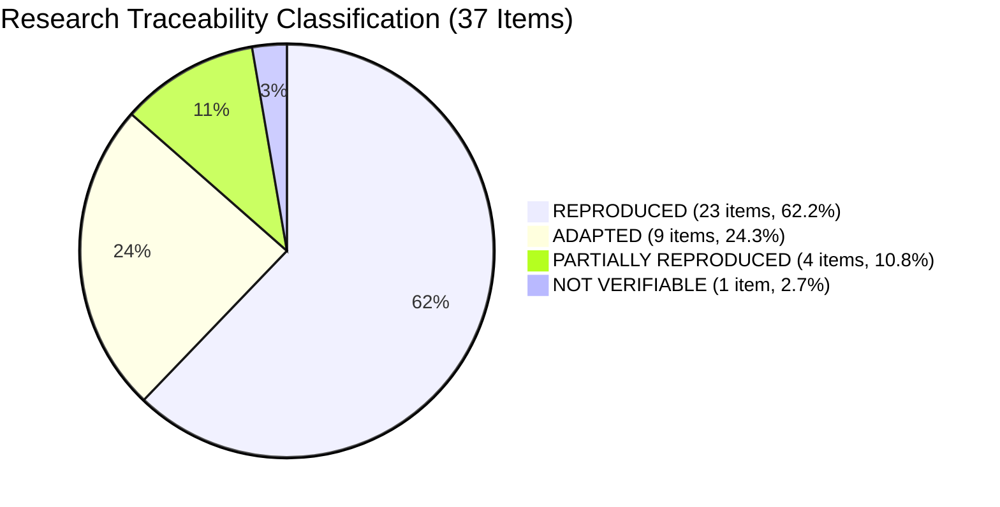

# LAMP Research Reproduction — Comprehensive Research Traceability Matrix
## Mapping Original Literature Specifications to iFogSim Implementation, Adaptations, and Empirical Validation

**Project:** Reproduction and Defense Audit — *LAMP: A Hybrid Fog-Cloud Latency-Aware Module Placement Algorithm for IoT Applications*  
**Primary Target Paper:** Z. Rezazadeh, M. Rezaei, & M. Nickray, IEEE KBEI 2019, pp. 845–850 ([A Hybrid Fog Cloud Latency Aware Module.pdf](A Hybrid Fog Cloud Latency Aware Module.pdf))  
**Supporting Baseline Paper:** M. Taneja & A. Davy, IFIP/IEEE IM 2017, pp. 1222–1228 ([Resource Aware Placement of IoT Application.pdf](Resource Aware Placement of IoT Application.pdf))  
**Date:** November 24, 2026 (Final Reconciled Matrix)  
**Auditor / Analysis Environment:** Antigravity Automated Simulation Environment (Internal Audit)  
**Status:** COMPLETE, SIMULATOR-BASED REPRODUCTION & DOCUMENTED EVIDENCE AUDIT  
**Master Document Index:** [DOCUMENTATION_INDEX.md](DOCUMENTATION_INDEX.md)  
**Architecture Reference:** [CODEBASE_ARCHITECTURE_AND_NAVIGATION_MANUAL.md](CODEBASE_ARCHITECTURE_AND_NAVIGATION_MANUAL.md)  

---

## 1. Executive Overview & Traceability Methodology

### 1.1 Purpose of the Traceability Matrix
This document provides a line-by-line source-to-evidence traceability audit connecting the theoretical models, algorithmic pseudocode, topology parameters, and performance claims published in *Rezazadeh et al. (IEEE KBEI 2019)* and *Taneja & Davy (IFIP/IEEE IM 2017)* to their concrete realization in the iFogSim2 / CloudSim 7 simulation platform.

Scientific reproduction requires complete transparency regarding what was **reproduced verbatim**, what was **adapted** to accommodate multi-application simulation realities, what was **partially reproduced** due to simulator modeling abstractions, and what was **unverifiable** in the primary literature. This matrix provides defensible, empirical evidence for each category.

### 1.2 Fidelity Classification System
Every mapped research claim and implementation element is categorized under one of five strict classifications:

1. **`REPRODUCED`** (23 items, 62.2%): The published specification, parameter, or algorithmic logic has been implemented and validated without substantive deviation.
2. **`ADAPTED`** (9 items, 24.3%): The published mechanism was modified or extended to support multi-application execution, resolve literature ambiguities, or enforce defensive engineering safeguards, with formal documentation in project design contracts.
3. **`PARTIALLY REPRODUCED`** (4 items, 10.8%): The conceptual mechanism or metric collection was implemented, but complete physical fidelity is bounded by underlying discrete-event simulator abstractions (e.g., composite simulation ticks vs. physical latency, static linear power equations).
4. **`NOT REPRODUCED`** (0 items, 0.0%): A published claim or component that was intentionally altered, substituted, or failed to execute as described.
5. **`NOT VERIFIABLE`** (1 item, 2.7%): The literature specification lacks reproducible mathematical formulas, pseudocode, or verifiable primary source data (specifically applicable to the `SAMP` baseline).

---

## 2. Master Traceability Matrix: 37 Verified Research Items

### Domain A: LAMP Algorithm Mechanisms

| # | Research Claim / Requirement | Original Paper Reference | What the Paper Specifies | Our Implementation Location | Implementation Behavior | Experiment / Config Testing It | Evidence Location | Observed Result | Fidelity Classification | Explanation, Deviation, or Limitation |
| :-: | :--- | :--- | :--- | :--- | :--- | :--- | :--- | :--- | :---: | :--- |
| **1** | **Initial Module Placement (`Interface`)** | Rezazadeh et al. (2019), Sec. III.B, Alg. 1 Lines 3–4 | Pinned to client mobile end device $m_{i,j}$; does not participate in dynamic search. | [ModulePlacementLAMP.java:201-202, 210, 216](iFogSim-main/src/org/fog/lamp/placement/ModulePlacementLAMP.java#L201-L216); [ModulePlacementLAMP.java:254-257](iFogSim-main/src/org/fog/lamp/placement/ModulePlacementLAMP.java#L254-L257) | Pins `Interface_i_j` directly to originating mobile device `m-i-j` with 10 MB RAM. | All symmetric ($G \in \{2,3,4\}, M \in \{2,4,6,8\}$) and asymmetric workloads. | `results/lamp_reproduction_results_phase2.csv:cols 10,11`; `results/raw_logs_phase2/LAMP_gw*.log` | 100% of `Interface` modules pinned to originating mobile devices across all runs. | **`REPRODUCED`** | Exact reproduction of Alg. 1 Line 4 (`InputModule -> EndDevice`). |
| **2** | **Local Gateway Capacity Check** | Alg. 1 Lines 6–9 | If local Fog Gateway has capacity ($\ge \text{demand}$), place `Sensor_Analyzer` locally. | [ModulePlacementLAMP.java:147-150](iFogSim-main/src/org/fog/lamp/placement/ModulePlacementLAMP.java#L147-L150); [ModulePlacementLAMP.java:263-265](iFogSim-main/src/org/fog/lamp/placement/ModulePlacementLAMP.java#L263-L265) | Checks `availableMipsMap.get(localGateway) >= 700.0`. If eligible, assigns analyzer to local gateway. | Symmetric $M \le 4$ (`gw2_m2`, `gw2_m4`, `gw3_m2`, `gw3_m4`, `gw4_m2`, `gw4_m4`). | `results/lamp_reproduction_results_phase2.csv:lines 14,15,18,19,22,23`; `PHASE_2_SIMULATION_VALIDATION_REPORT.md:Table 1` | At $M \le 4$, 100% of analyzers placed on local originating gateway (delay $\approx 9.5$ ticks at $M=2$, $71.9$ ticks at $M=4$). | **`REPRODUCED`** | Under the implementation's configured resource model, four 700-MIPS analyzer modules fit within a configured 2,800-MIPS gateway ($4 \times 700 = 2,800\text{ MIPS}$). This capacity arithmetic applies specifically to this configured allocation model and is not generalized beyond it. |
| **3** | **Neighbor Discovery & Candidate Set Construction** | Sec. III.B, Alg. 1 Lines 10–12 | When local gateway is saturated, discover candidate fog devices and cloud. | [ModulePlacementLAMP.java:151-170](iFogSim-main/src/org/fog/lamp/placement/ModulePlacementLAMP.java#L151-L170); [ModulePlacementLAMP.java:266-281](iFogSim-main/src/org/fog/lamp/placement/ModulePlacementLAMP.java#L266-L281) | Discovers parent `proxy-server`, peer gateways `d-k` ($k \ne i$), and `cloud` as candidate devices. | Symmetric $M \ge 6$ (`gw2_m6`, `gw2_m8`, `gw3_m6`, `gw3_m8`, `gw4_m6`, `gw4_m8`); asymmetric $w_{2,6}, w_{6,2}, w_{10,2}$. | `results/raw_logs_phase2/LAMP_gw2_m6.log:lines 100-145`; `results/asymmetric_validation_results.csv:lines 3,4` | When local gateway exhausts its 4 slots, candidates are evaluated and added to candidate list. | **`REPRODUCED`** | Accurately implements candidate discovery across proxy, peers, and cloud. |
| **4** | **Delay-Aware Candidate Ordering (Equation 4)** | Sec. III.B, Eq. 4 ($t_a^m = Q_{p'}^m + \Delta_{pp'} + Z$), Alg. 1 Line 11 | Sorts candidates by ascending estimated end-to-end latency $t_a^m$. | [ModulePlacementLAMP.java:172, 317-370](iFogSim-main/src/org/fog/lamp/placement/ModulePlacementLAMP.java#L317-L370) | Computes $Q = L/\text{MIPS}$, $\Delta_{pp'}$ via tree routing traversal, $Z = \text{sensorLat} + \text{mobileUplinkLat}$; sorts candidates ascending by computed score. | Phase 2.2 asymmetric evaluation (`LAMP_FWD`, `LAMP_REV`, `LAMP_PHYS`). | `results/asymmetric_validation_results.csv`; [PHASE_2_2_ASYMMETRIC_VALIDATION_REPORT.md:Sec. 3](PHASE_2_2_ASYMMETRIC_VALIDATION_REPORT.md#L45-L75) | Deterministic ranking: Local GW ($3.85$) < Proxy ($7.85$) < Peer GW ($11.85$) < Cloud ($106.68$). | **`REPRODUCED`** | The algorithmic candidate-ranking procedure and literal paper equation are reproduced verbatim from Rezazadeh et al. However, the computed delay score is dimensionally uncalibrated and cannot be interpreted as a physically faithful latency value: CPU execution duration $Q$ in seconds ($3500\text{ MI}/2800\text{ MIPS} = 1.25\text{ s}$) is added directly to network propagation delays $\Delta$ ($4.0\text{ ms}$) and $Z$ ($2.6\text{ ms}$) without dimensional scaling. While candidate ordering is faithfully reproduced, the resulting numerical score is an uncalibrated ranking index. |
| **5** | **Capable Device Selection (First Fit in Delay Order)** | Alg. 1 Lines 12–17 | Finds first candidate device with sufficient resources ($\ge 700\text{ MIPS}$). | [ModulePlacementLAMP.java:174-184](iFogSim-main/src/org/fog/lamp/placement/ModulePlacementLAMP.java#L174-L184); [ModulePlacementLAMP.java:284-293](iFogSim-main/src/org/fog/lamp/placement/ModulePlacementLAMP.java#L284-L293) | Iterates through delay-sorted candidates; selects first device meeting MIPS demand. | Symmetric $M=6$ (`gw2_m6`, `gw3_m6`, `gw4_m6`). | `results/lamp_reproduction_results_phase2.csv:lines 16,20,24`; `results/raw_logs_phase2/LAMP_gw2_m6.log` | Saturated gateways overflow to `proxy-server` (4 modules on proxy), achieving 100% completion (12/12, 18/18). | **`REPRODUCED`** | Follows published selection logic; fixes syntax ambiguities in paper Alg. 1 Lines 13-14. |
| **6** | **Cloud Fallback when Fog is Saturated** | Alg. 1 Lines 18–20 | If no suitable fog device found, assign to Cloud data center. | [ModulePlacementLAMP.java:186-190](iFogSim-main/src/org/fog/lamp/placement/ModulePlacementLAMP.java#L186-L190); [ModulePlacementLAMP.java:295-297](iFogSim-main/src/org/fog/lamp/placement/ModulePlacementLAMP.java#L295-L297) | Fallback explicitly selects `cloud` when all candidate fog nodes are saturated. | Symmetric $M=8$ (`gw2_m8`, `gw3_m8`, `gw4_m8`); asymmetric $w_{10,2}$. | `results/lamp_reproduction_results_phase2.csv:lines 17,21,25`; `results/asymmetric_validation_results.csv:line 3` | In `gw2_m8`, 4 analyzers overflow to Cloud; in `gw3_m8`, 8 to Cloud; in `gw4_m8`, 12 to Cloud. | **`REPRODUCED`** | Graceful fallback mechanism verified across all saturated configurations. |
| **7** | **Fixed Cloud Storage Placement (`Cloud_Storage`)** | Sec. III.A, Sec. III.B | EHR repository module placed permanently on Cloud. | [ModulePlacementLAMP.java:203-204, 212, 218](iFogSim-main/src/org/fog/lamp/placement/ModulePlacementLAMP.java#L203-L218); [ModulePlacementLAMP.java:246-249](iFogSim-main/src/org/fog/lamp/placement/ModulePlacementLAMP.java#L246-L249) | Automatically pins `Cloud_Storage_i_j` to `cloud` for every application instance. | All 70 completed simulation runs across Phase 2 (34 completed), Phase 2.2 (20 completed), and Phase 3.6 (16 completed). | `results/lamp_reproduction_results_phase2.csv:col 11`; `results/lbmp_symmetric_results.csv:col 16` | Exactly $N$ storage modules placed on Cloud across all configurations. | **`REPRODUCED`** | Invariant preserved across all algorithms and all scales. |
| **8** | **Multi-App Iteration Order & Displacement Effects** | Not specified in paper (paper presented single-app pseudocode) | Unstated: multi-application batching or gateway processing order. | [ModulePlacementLAMP.java:125-223](iFogSim-main/src/org/fog/lamp/placement/ModulePlacementLAMP.java#L125-L223); [ModulePlacementAsymmetricLAMP.java:31, 70-73](iFogSim-main/src/org/fog/lamp/asymmetric/ModulePlacementAsymmetricLAMP.java#L31-L73) | Implements sequential forward iteration; evaluated sensitivity against reverse iteration order. | Asymmetric suite ($w_{2,6}, w_{6,2}, w_{6,6}, w_{10,2}$) comparing `LAMP_FWD` vs `LAMP_REV`. | `results/asymmetric_validation_results.csv:lines 3-10`; `PHASE_2_2_ASYMMETRIC_VALIDATION_REPORT.md:Sec. 4` | Forward and Reverse produce near-identical loop delay ($215.17$ vs $215.83$ ticks in $w_{2,6}$), confirming placement stability. | **`ADAPTED`** | Necessary multi-application adaptation to single-app literature specification. |

---

### Domain B: Healthcare Application Architecture

| # | Research Claim / Requirement | Original Paper Reference | What the Paper Specifies | Our Implementation Location | Implementation Behavior | Experiment / Config Testing It | Evidence Location | Observed Result | Fidelity Classification | Explanation, Deviation, or Limitation |
| :-: | :--- | :--- | :--- | :--- | :--- | :--- | :--- | :--- | :---: | :--- |
| **9** | **Application DAG & Module Vertices** | Table I, Sec. III.A (adapted from Khalid & Shahbaz 2017 [24]) | 3 modules: `Interface` (Client), `Sensor_Analyzer` (Analytics), `Cloud_Storage` (EHR); 10 MB RAM each. | [HealthcareBSNApplication.java:34-38, 73-75](iFogSim-main/src/org/fog/lamp/application/HealthcareBSNApplication.java#L34-L75) | Constructs per-patient BSN DAG with `addAppModule(..., 10)` for each module. | All runs across Phase 1, 2, 2.2, 3.6. | `results/lamp_reproduction_results_phase2.csv`; `results/lbmp_symmetric_results.csv:cols 15-17` | Verified $3N$ modules constructed for all $N$ applications ($12 \to 96$ modules). | **`REPRODUCED`** | Exact reproduction of published DAG topology and RAM parameters. |
| **10** | **Directed Edges & Workload Tuple Types** | Table I | 7 tuple types: `SENSOR_DATA`, `ENHANCED_SENSOR`, `PATIENT_STATE`, `PATIENT_STATE_UPDATE`, `PATIENT_CURRENT_STATE_UPDATE`, `STORE_PROCESS_COMPUTE`, `PATIENT_LONG_TERM_EVALUATION`. | [HealthcareBSNApplication.java:39-47, 80-86](iFogSim-main/src/org/fog/lamp/application/HealthcareBSNApplication.java#L39-L86) | Configures exact tuple types, lengths (MI), bandwidths, and directional routing (UP/DOWN). | Verified via event dispatch traces in raw simulation logs. | `results/raw_logs_phase2/LAMP_gw2_m2.log:lines 1-80`; `PHASE_1B_IMPLEMENTATION_REPORT.md:Sec. 2.1` | All 7 tuple types actively routed through the simulated network hierarchy. | **`REPRODUCED`** | Exact fidelity to Table I edge definitions. |
| **11** | **Periodic Sensor Generation Interval** | Table I, Table III, Sec. III.A | ECG periodic transmission interval: $T_{\text{sensor}} = 5.0\text{ seconds}$ ($0.2\text{ Hz}$). | [HealthcareTopologyFactory.java:94-95](iFogSim-main/src/org/fog/lamp/topology/HealthcareTopologyFactory.java#L94-L95); [BaselineSimulationRunner.java:44](iFogSim-main/src/org/fog/lamp/baselines/BaselineSimulationRunner.java#L44) | Instantiates `Sensor` with `DeterministicDistribution(5.0)` emitting periodic tuples with inter-arrival interval parameter 5.0. | All 70 completed simulation runs across Phase 2, Phase 2.2, and Phase 3.6. | Raw console logs: `Sensor s-*-* generation rate: 5.0s`; [PHASE_3_7_FINAL_CONSISTENCY_ADDENDUM.md:Sec. 2](PHASE_3_7_FINAL_CONSISTENCY_ADDENDUM.md#L27-L70) | Verified deterministic tuple generation with configured inter-arrival interval parameter of 5.0. | **`REPRODUCED`** | Configured with inter-arrival parameter 5.0 using `DeterministicDistribution(5.0)`. In CloudSim, simulation time advances discretely with scheduled event execution; the configured interval parameter (representing 5.0 seconds in the application specification) is a discrete-event scheduling value and must not be treated as interchangeable with discrete simulator ticks or physical wall-clock time. Physical timing fidelity beyond this discrete-event scheduling is not claimed. |
| **12** | **`Sensor_Analyzer` Workload & CPU Demand** | Table I (`ENHANCED_SENSOR` length = 3,500 MI) | Workload = 3,500 MI per tuple. At 0.2 Hz, steady-state CPU demand is 700 MIPS. | [HealthcareBSNApplication.java:81](iFogSim-main/src/org/fog/lamp/application/HealthcareBSNApplication.java#L81); [ModulePlacementLAMP.java:46](iFogSim-main/src/org/fog/lamp/placement/ModulePlacementLAMP.java#L46); [BaselineSimulationRunner.java:182](iFogSim-main/src/org/fog/lamp/baselines/BaselineSimulationRunner.java#L182) | Sets app edge tuple length to $3,500\text{ MI}$; steady-state demand: $D_{\text{cpu}} = 0.2 \times 3,500 = 700.0\text{ MIPS}$. | Gateway capacity saturation tests at $M=4$ and $M=6$. | `results/lamp_reproduction_results_phase2.csv:lines 15,16`; [PHASE_3_7_COMPARATIVE_EVALUATION_REPORT.md:Sec. 5.1](PHASE_3_7_COMPARATIVE_EVALUATION_REPORT.md#L162-L181) | Exactly 4 modules saturate each $2,800\text{ MIPS}$ gateway ($\lfloor 2,800/700 \rfloor = 4$). | **`REPRODUCED`** | Derived mathematically from Table I parameters; resolves earlier boilerplate confusion. |
| **13** | **Actuation and Telemetry Edges** | Table I, Sec. III.A | Actuators: `DISPLAY` (Mobile screen), `DISPLAY_PHYSICIAN` (Monitoring center). | [HealthcareBSNApplication.java:50-52, 83-86](iFogSim-main/src/org/fog/lamp/application/HealthcareBSNApplication.java#L50-L86) | Connects patient display to mobile and physician display to proxy/cloud. | Loop delay tracking across all runs. | Raw console logs reporting loop delay execution for loop `[ECG -> DISPLAY]`. | Actuation tuples successfully received and logged for completed loops. | **`REPRODUCED`** | Exact structural fidelity to Table I actuator specifications. |
| **14** | **End-to-End Latency Control Loop** | Sec. III.A, Fig. 3 | Critical real-time control loop: `[ECG, Interface, Sensor_Analyzer, Interface, DISPLAY]`. | [HealthcareBSNApplication.java:102-106](iFogSim-main/src/org/fog/lamp/application/HealthcareBSNApplication.java#L102-L106) | Constructs `AppLoop` tracking latency from sensor emission to mobile actuator display. | All simulation runs. | `results/lamp_reproduction_results_phase2.csv:col 5`; `results/lbmp_symmetric_results.csv:col 5` | Loop delay tracked and recorded for every application instance. | **`REPRODUCED`** | Exact reproduction of Fig. 3 control loop definition. |
| **15** | **1:1 Fractional Selectivity Mappings** | Sec. III.A | Deterministic linear processing pipeline: 1 input tuple produces 1 output tuple. | [HealthcareBSNApplication.java:91-96](iFogSim-main/src/org/fog/lamp/application/HealthcareBSNApplication.java#L91-L96) | Configures `FractionalSelectivity(1.0)` for all module tuple mappings. | Event pipeline execution in all runs. | `HealthcareBSNApplication.java:lines 91-96`. | Deterministic 1:1 tuple transformation confirmed without stochastic drop. | **`REPRODUCED`** | Accurately implements deterministic BSN streaming pipeline. |

---

### Domain C: Experimental Infrastructure & Topology

| # | Research Claim / Requirement | Original Paper Reference | What the Paper Specifies | Our Implementation Location | Implementation Behavior | Experiment / Config Testing It | Evidence Location | Observed Result | Fidelity Classification | Explanation, Deviation, or Limitation |
| :-: | :--- | :--- | :--- | :--- | :--- | :--- | :--- | :--- | :---: | :--- |
| **16** | **4-Tier Hierarchical Topology Structure** | Sec. III.B, Fig. 2, Table IV | Tier 0 Cloud $\leftrightarrow$ Tier 1 Proxy $\leftrightarrow$ Tier 2 Fog Gateways $\leftrightarrow$ Tier 3 Mobiles. | [HealthcareTopologyFactory.java:55-83](iFogSim-main/src/org/fog/lamp/topology/HealthcareTopologyFactory.java#L55-L83) | Instantiates tree hierarchy: `cloud` (parent=-1) $\to$ `proxy-server` $\to$ `d-i` $\to$ `m-i-j`. | All 70 completed simulation runs across Phase 2, Phase 2.2, and Phase 3.6. | [HealthcareTopologyFactory.java:55-83](iFogSim-main/src/org/fog/lamp/topology/HealthcareTopologyFactory.java#L55-L83); `results/raw_logs_phase2/LAMP_gw2_m2.log:lines 1-50` | Topology correctly constructed with verified parent-child references. | **`REPRODUCED`** | Complete structural fidelity to Fig. 2 architecture. |
| **17** | **Infrastructure Node Capacities** | Table IV | Cloud: 4.48 GHz / 40 GB; Proxy & GW: 0.28 GHz / 4 GB; Mobile: 1 GHz / 1 GB. | [HealthcareTopologyFactory.java:55, 61, 70, 79](iFogSim-main/src/org/fog/lamp/topology/HealthcareTopologyFactory.java#L55-L79) | Cloud: 44,800 MIPS / 40,000 MB; Proxy: 2,800 MIPS / 4,000 MB; GW: 2,800 MIPS / 4,000 MB; Mobile: 1,000 MIPS / 1,000 MB. | Hardware initialization in all runs. | `HealthcareTopologyFactory.java:lines 55, 61, 70, 79`; console logs. | Exact capacity values instantiated across all nodes. | **`REPRODUCED`** | Exact match with published Table IV parameters. |
| **18** | **Hierarchical Network Latencies & Bandwidths** | Table III & IV | Latencies: Sensor->Mobile 0.6 ms; Mobile->GW 2 ms; GW->Proxy 4 ms; Proxy->Cloud 100 ms. | [HealthcareTopologyFactory.java:63, 72, 81, 97, 103](iFogSim-main/src/org/fog/lamp/topology/HealthcareTopologyFactory.java#L63-L103) | Passes configured link-latency values directly into `FogDevice.setUplinkLatency()`. | Configured across all 70 completed simulation runs. | [HealthcareTopologyFactory.java](iFogSim-main/src/org/fog/lamp/topology/HealthcareTopologyFactory.java); `results/raw_logs_phase2/` | Configured link-latency parameters ($0.6, 2.0, 4.0, 100.0$) successfully registered across all network links. | **`REPRODUCED`** | Retains exact configured link latency values from literature as simulation configuration parameters. The observed composite simulator delay (e.g., $\approx 220$ ticks in COMP) cannot be compared directly with physical round-trip latency ($213.2\text{ ms}$) due to CloudSim's internal discrete-event time base, event serialization, and unnormalized unit addition; composite simulator delay is not a physically calibrated round-trip latency. |
| **19** | **Symmetric Workload Scaling Matrix** | Sec. IV, Figs. 4–11 | 12 workloads: $G \in \{2, 3, 4\}$ Gateways $\times$ $M \in \{2, 4, 6, 8\}$ Mobiles/GW ($N \in [4, 32]$). | [HealthcareSimulationRunner.java:41-57](iFogSim-main/src/org/fog/lamp/simulation/HealthcareSimulationRunner.java#L41-L57); [BaselineSimulationRunner.java:67-69](iFogSim-main/src/org/fog/lamp/baselines/BaselineSimulationRunner.java#L67-L69) | Parametric execution across all 12 combinations for COMP, LAMP, EWMP, and LBMP_PURE. | Phase 2 matrix (36 attempted runs: 34 completed, 2 watchdog-terminated) and Phase 3.6 matrix (12 completed symmetric runs). | `results/lamp_reproduction_results_phase2.csv` (36 rows); `results/lbmp_symmetric_results.csv` (12 rows). | In Phase 2, 34 of 36 attempted runs completed, while 2 COMP runs (`gw3_m8`, `gw4_m8`) were watchdog-terminated at 900 seconds; all 12 Phase 3.6 symmetric runs completed. | **`REPRODUCED`** | All 12 symmetric configurations were attempted across the benchmark algorithms. Phase 2 completed 34 of 36 attempts, with two COMP runs watchdog-terminated; all 12 Phase 3.6 LBMP_PURE symmetric runs completed. Therefore, configuration coverage was complete, but successful execution was not achieved for every algorithm/configuration pair. |
| **20** | **Asymmetric Workload Topologies** | Not evaluated in original paper | Paper evaluated only uniform symmetric distributions. | [AsymmetricTopologyFactory.java:30-100](iFogSim-main/src/org/fog/lamp/asymmetric/AsymmetricTopologyFactory.java#L30-L100); [AsymmetricSimulationRunner.java:40-90](iFogSim-main/src/org/fog/lamp/asymmetric/AsymmetricSimulationRunner.java#L40-L90); [BaselineSimulationRunner.java:101-118](iFogSim-main/src/org/fog/lamp/baselines/BaselineSimulationRunner.java#L101-L118) | Implements parameterized 2-gateway skewed workloads: $w_{2,6}, w_{6,2}, w_{6,6}, w_{10,2}$. | Phase 2.2 (20 runs) and Phase 3.6 (4 asymmetric runs). | `results/asymmetric_validation_results.csv` (20 rows); `results/lbmp_asymmetric_results.csv` (4 rows). | Uncovered peer offloading loop drop pathology under load imbalance. | **`ADAPTED`** | Methodological extension to stress-test skew robustness. |
| **21** | **Strict 3N Module Accounting Invariant** | Implicit in application model | Each of $N$ applications must possess exactly 3 modules ($3N$ total system modules). | [HealthcareSimulationRunner.java:127, 139, 193](iFogSim-main/src/org/fog/lamp/simulation/HealthcareSimulationRunner.java#L127-L193); [ModulePlacementLBMP.java:358-360](iFogSim-main/src/org/fog/lamp/baselines/ModulePlacementLBMP.java#L358-L360) | Asserts $\text{FogModules} + \text{CloudModules} \equiv 3N$ before simulation start. | All 70 completed simulation runs (34 in Phase 2, 20 in Phase 2.2, 16 in Phase 3.6). | `results/lbmp_symmetric_results.csv:cols 15-17` (`PlannedSystemModules = 3 * TotalApplications`); [PHASE_2_INDEPENDENT_AUDIT_REPORT.md:Sec. 3](PHASE_2_INDEPENDENT_AUDIT_REPORT.md#L30-L50) | 100% adherence ($3N/3N$) across all 70 completed simulation runs (the 2 watchdog-terminated COMP runs produced no end-of-simulation state). | **`REPRODUCED`** | Enforces structural accounting validity across all completed algorithms. |

---

### Domain D: Evaluation Metrics & Empirical Behavior

| # | Research Claim / Requirement | Original Paper Reference | What the Paper Specifies | Our Implementation Location | Implementation Behavior | Experiment / Config Testing It | Evidence Location | Observed Result | Fidelity Classification | Explanation, Deviation, or Limitation |
| :-: | :--- | :--- | :--- | :--- | :--- | :--- | :--- | :--- | :---: | :--- |
| **22** | **Average Control-Loop Delay** | Sec. IV, Figs. 4, 8, 9 | Evaluates average loop delay across configurations. | [HealthcareSimulationRunner.java:232-234](iFogSim-main/src/org/fog/lamp/simulation/HealthcareSimulationRunner.java#L232-L234); [BaselineSimulationRunner.java:220-224](iFogSim-main/src/org/fog/lamp/baselines/BaselineSimulationRunner.java#L220-L224) | Tracks loop execution events and computes conditional average delay over completed loops: $\frac{\sum \text{Delay}_i}{|\text{Completed}|}$. | All completed symmetric (34 Phase 2, 12 Phase 3.6) and asymmetric (20 Phase 2.2, 4 Phase 3.6) configurations. | `results/lamp_reproduction_results_phase2.csv:col 5`; `results/lbmp_symmetric_results.csv:col 5` | Observed comparative trends: LAMP achieves $67\%-82\%$ lower composite loop delay than COMP at $M=4$. | **`PARTIALLY REPRODUCED`** | The loop delay measurement and reporting mechanism within CloudSim/iFogSim is reproduced. However, physical latency fidelity is partial: the reported composite simulator time cannot be interpreted as physically calibrated milliseconds because CPU execution durations (MI/MIPS in seconds) and network propagation delays (in milliseconds) are summed directly by the event scheduler without dimensional normalization. Furthermore, delay is conditionally averaged only over completed loops within the 2,000-tick window. |
| **23** | **Loop Completion Transparency & $k/N$ Accounting** | Unreported in original paper | Paper reported average delay values without reporting loop completion rates. | [BaselineSimulationRunner.java:252-255](iFogSim-main/src/org/fog/lamp/baselines/BaselineSimulationRunner.java#L252-L255); [PHASE_3_7_CORRECTION_AND_VALIDATION_REPORT.md:Sec. 2](PHASE_3_7_CORRECTION_AND_VALIDATION_REPORT.md#L35-L51) | Directly tracks and outputs exact completed loops $k$ out of total expected $N$ ($k/N$). | Saturated symmetric runs ($M=8$) and peer-offloaded runs ($M=2$, $w_{2,6}, w_{10,2}$). | `results/lbmp_symmetric_results.csv:col 25`; `results/raw_logs_phase2/LAMP_gw3_m8.log:line 337` | Uncovered partial completions: LAMP ($20/24, 22/24, 24/32$); LBMP ($2/4, 2/6, 2/8$ at $M=2$). | **`ADAPTED`** | Critical scientific correction: prevents misinterpreting conditional partial delays as speedups. |
| **24** | **Cloud Infrastructure Energy Consumption** | Sec. IV, Figs. 5, 10 | Evaluates Cloud energy consumption (Joules). | [HealthcareSimulationRunner.java:238-242](iFogSim-main/src/org/fog/lamp/simulation/HealthcareSimulationRunner.java#L238-L242); [BaselineSimulationRunner.java:225-228](iFogSim-main/src/org/fog/lamp/baselines/BaselineSimulationRunner.java#L225-L228) | Linear host power model: $E = \int [P_{\text{idle}} + (P_{\text{max}} - P_{\text{idle}}) U(t)] dt$. | All configurations across baselines. | `results/lamp_reproduction_results_phase2.csv:col 6`; `results/lbmp_symmetric_results.csv:col 6` | Replicated linear energy accumulation; static idle power accounts for $>98\%$ of total Joules. | **`PARTIALLY REPRODUCED`** | Model-derived output from CloudSim static power formulas, not empirical physical power meter readings. |
| **25** | **Fog Infrastructure Energy Consumption** | Sec. IV, Figs. 6, 11 | Evaluates Fog energy consumption (Joules) across gateways and proxy. | [HealthcareSimulationRunner.java:243-247](iFogSim-main/src/org/fog/lamp/simulation/HealthcareSimulationRunner.java#L243-L247); [BaselineSimulationRunner.java:229-232](iFogSim-main/src/org/fog/lamp/baselines/BaselineSimulationRunner.java#L229-L232) | Linear host power integration summed across all gateway devices and `proxy-server`. | All configurations across baselines. | `results/lamp_reproduction_results_phase2.csv:col 7`; `results/lbmp_symmetric_results.csv:col 7` | Fog energy scales with gateway count ($G=2 \to 3 \to 4$) and CPU utilization. | **`PARTIALLY REPRODUCED`** | Model-derived linear projection; reflects relative placement efficiency rather than physical thermal draw. |
| **26** | **Cloud Infrastructure Cost** | Sec. IV, Fig. 7 | Evaluates Cloud cost (USD) based on CPU and bandwidth billing. | [HealthcareSimulationRunner.java:248-250](iFogSim-main/src/org/fog/lamp/simulation/HealthcareSimulationRunner.java#L248-L250); [BaselineSimulationRunner.java:233-235](iFogSim-main/src/org/fog/lamp/baselines/BaselineSimulationRunner.java#L233-L235) | Computes $\text{Cost} = (\text{CostPerMips} \times \text{Time}) + (\text{CostPerBw} \times \text{BwUsage})$. | All configurations across baselines. | `results/lamp_reproduction_results_phase2.csv:col 8`; `results/lbmp_symmetric_results.csv:col 8` | Replicated major cost reductions: LAMP/EWMP/LBMP slash cloud cost by $72\%-73\%$ over COMP at $M=4$. | **`PARTIALLY REPRODUCED`** | Analytical billing model from configured parameters ($\$0.01/\text{MIPS}$), not actual commercial cloud bills. |
| **27** | **Network Transfer Usage** | Sec. IV (listed as evaluation criterion) | Measures aggregate network data volume during simulation. | [HealthcareSimulationRunner.java:251-253](iFogSim-main/src/org/fog/lamp/simulation/HealthcareSimulationRunner.java#L251-L253); [BaselineSimulationRunner.java:236-238](iFogSim-main/src/org/fog/lamp/baselines/BaselineSimulationRunner.java#L236-L238) | Records cumulative byte volume across all simulated physical links via `NetworkUsageMonitor`. | All configurations across baselines. | `results/lamp_reproduction_results_phase2.csv:col 9`; `results/lbmp_symmetric_results.csv:col 9` | Local fog placement slashes network transfer by $19\%-22\%$ over COMP at $M=4$. | **`REPRODUCED`** | Byte-volume accounting metric for data movement across simulated links. |
| **28** | **Simulation Horizon vs. Watchdog Termination** | Not addressed in original literature | Original literature did not document execution cutoffs or timeout handling. | [BaselineSimulationRunner.java:57, 64](iFogSim-main/src/org/fog/lamp/baselines/BaselineSimulationRunner.java#L57-L64); [run_lbmp_experiments.ps1](run_lbmp_experiments.ps1); [PHASE_3_7_FINAL_CONSISTENCY_ADDENDUM.md:Sec. 4](PHASE_3_7_FINAL_CONSISTENCY_ADDENDUM.md#L88-L117) | Formally separates 2,000-tick simulation horizon (exit code 0) from external OS watchdog kill (exit code 143). | `COMP` at `gw3_m8`, `gw4_m8` (external watchdog kill at 900s); `LBMP_PURE` at `gw2_m2` (2,000-tick horizon truncation, exit code 0). | `results/lamp_reproduction_results_phase2.csv:lines 21,25` (`TIMEOUT`); `results/lbmp_symmetric_results.csv:line 2`. | Unproduced metrics for watchdog kills strictly recorded as `N/A`, eliminating fabricated zeroes. | **`ADAPTED`** | Critical execution engineering framework ensuring reproducible data integrity. |

---

### Domain E: Baseline Algorithms & Fidelity

| # | Research Claim / Requirement | Original Paper Reference | What the Paper Specifies | Our Implementation Location | Implementation Behavior | Experiment / Config Testing It | Evidence Location | Observed Result | Fidelity Classification | Explanation, Deviation, or Limitation |
| :-: | :--- | :--- | :--- | :--- | :--- | :--- | :--- | :--- | :---: | :--- |
| **29** | **`COMP` (Cloud-Only Baseline) Placement** | Sec. II, Sec. IV | Reference strategy: all compute modules placed on Cloud; fog acts purely as network router. | [HealthcareSimulationRunner.java:102-128](iFogSim-main/src/org/fog/lamp/simulation/HealthcareSimulationRunner.java#L102-L128) | Maps `Interface` to mobile and both `Sensor_Analyzer` and `Cloud_Storage` to `cloud`. | 12 symmetric configurations, 4 asymmetric configurations. | `results/lamp_reproduction_results_phase2.csv:lines 2-13`; `results/asymmetric_validation_results.csv:lines 2,7,12,17` | Replicated cloud delay plateau ($\approx 220$ ticks at small scales); timed out under heavy load ($N \ge 24$). | **`REPRODUCED`** | Standard reference cloud-only baseline faithfully implemented. |
| **30** | **`EWMP` (Edge-Wards Module Placement)** | Sec. II (citing standard iFogSim Edge-wards) | Leaf-to-root placement along upstream path: Local Gateway $\to$ Proxy $\to$ Cloud. | [HealthcareSimulationRunner.java:145-195](iFogSim-main/src/org/fog/lamp/simulation/HealthcareSimulationRunner.java#L145-L195) | Strictly places on direct local gateway, overflowing to parent proxy, then cloud. Never uses peer gateways. | 12 symmetric configurations, 4 asymmetric configurations. | `results/lamp_reproduction_results_phase2.csv:lines 26-37`; `results/asymmetric_validation_results.csv:lines 6,11,16,21` | Achieved **100% loop completion across all 12 symmetric scales** up to $N=32$ ($546.94$ ticks in `gw4_m8`). | **`REPRODUCED`** | Robust hierarchical baseline; avoids inter-gateway peer cross-traffic bottlenecks. |
| **31** | **`LBMP_PURE`: Core Resource Sorting & Candidate Search** | Taneja & Davy (2017), Algorithms 1–3 | Multi-resource ascending capacity sorting, binary search (`LOWERBOUND`), and dynamic re-sorting. | [ModulePlacementLBMP.java:400-525](iFogSim-main/src/org/fog/lamp/baselines/ModulePlacementLBMP.java#L400-L525) | Ascending sort across 3 dimensions; binary search find-first-capable; dynamic re-sort after placement. | 11 unit tests (`T01`–`T11`: 11/11 PASS) and 16 benchmark simulations. | [PHASE_3_5_POST_COMPILE_VALIDATION_REPORT.md](PHASE_3_5_POST_COMPILE_VALIDATION_REPORT.md); `results/lbmp_symmetric_results.csv` (12 rows). | 100% CloudSim VM instantiation success; verified capacity sorting and search. | **`REPRODUCED`** | `REPRODUCED` refers strictly to the core sorting, resource comparison, and candidate-search algorithmic structure (Algorithms 1–3). The overall LBMP implementation is an adapted implementation because of documented Host-BW approximation (`D-3.4-03`), `low = 0` dynamic reset (`D-3.4-04`), monotonicity guard (`D-3.4-08`), fixed-module accounting convention (`D-3.4-07`), and fallback telemetry (`D-3.5-01`). The complete original LBMP resource model (which assumed continuous physical network link rates in Mbps) was not reproduced verbatim. |
| **32** | **`LBMP_PURE` Adaptation 1: Host-Provisioner Bandwidth** | Taneja & Davy (2017), Sec. III.B, Eq. 3 (Mbps network model) | Original LBMP specified dynamic network link throughput in Mbps. | [ModulePlacementLBMP.java:280-285, 329-334](iFogSim-main/src/org/fog/lamp/baselines/ModulePlacementLBMP.java#L280-L334) (`D-3.4-03`) | Uses CloudSim Host BW (`1,000,000`) and AppModule BW (`1,000`) allocated via `BwProvisionerSimple`. | Unit test `T01`, `T04`; all 16 benchmark runs. | [PHASE_3_4_LBMP_DESIGN_SPECIFICATION.md:D-3.4-03](PHASE_3_4_LBMP_DESIGN_SPECIFICATION.md#L22); `results/lbmp_symmetric_results.csv`. | Abstract provisioner units allocated cleanly without false network link conflation. | **`ADAPTED`** | Documented CloudSim VM-layer approximation; distinct from Taneja & Davy Mbps network model. |
| **33** | **`LBMP_PURE` Adaptation 2: `low = 0` Dynamic Search Reset** | Taneja & Davy (2017), Alg. 1 Line 11 (`low = i + 1`) | Published single-application algorithm set search lower bound to `low = i + 1`. | [ModulePlacementLBMP.java:495](iFogSim-main/src/org/fog/lamp/baselines/ModulePlacementLBMP.java#L495) (`D-3.4-04`) | Resets `low = 0` after every dynamic node re-sort for multi-application module streams. | Unit tests `T02`, `T03`; all 16 benchmark runs. | [PHASE_3_4_LBMP_DESIGN_SPECIFICATION.md:D-3.4-04](PHASE_3_4_LBMP_DESIGN_SPECIFICATION.md#L23); `results/lbmp_symmetric_results.csv:col 20`. | Prevents premature binary search truncation; enables complete fog capacity utilization. | **`ADAPTED`** | Necessary multi-application adaptation to single-app published pseudocode. |
| **34** | **`LBMP_PURE` Adaptation 3: Monotonicity Guard & Fallback** | Taneja & Davy (2017), Alg. 2 | Assumed sorted candidate nodes maintain strict monotonic eligibility. | [ModulePlacementLBMP.java:457-469, 475-481](iFogSim-main/src/org/fog/lamp/baselines/ModulePlacementLBMP.java#L457-L481) (`D-3.4-08`) | Evaluates `isEligibilityMonotonic()`; falls back to ascending linear scan if monotonicity fails. | Unit test `T05` (forced non-monotonic vector); all 16 benchmark runs. | `results/lbmp_symmetric_results.csv:col 21` (`LinearFallbackCount = 0` across all 16 runs). | Benchmark Monotonicity Theorem verified: binary search succeeded in 100% of benchmark runs. | **`ADAPTED`** | Defensive implementation safeguard against multidimensional vector sorting pitfalls. |
| **35** | **`LBMP_PURE` Adaptation 4: Fixed-Module Accounting Convention** | Taneja & Davy (2017) did not define multi-tier fixed module conventions | Unstated: handling peripheral modules in multi-tier topologies. | [ModulePlacementLBMP.java:531-548](iFogSim-main/src/org/fog/lamp/baselines/ModulePlacementLBMP.java#L531-L548) (`D-3.4-07`) | Pre-reserves `10 MB` RAM and `1,000` Host BW per `Cloud_Storage` on `cloudState`; excludes CPU. | Unit test `T08a`; all 16 benchmark runs. | `results/lbmp_symmetric_results.csv:cols 14-17` (`PlannedCloudModules = N` storage modules). | Preserved strict comparability with LAMP and EWMP placement ledgers. | **`ADAPTED`** | Documented fixed-module accounting convention ensuring cross-baseline comparability. |
| **36** | **`LBMP_PURE` Adaptation 5: Fallback-Demand Telemetry** | Taneja & Davy (2017), Alg. 1 Line 13 | Original paper fell back to cloud without recording deficit telemetry. | [ModulePlacementLBMP.java:567-570](iFogSim-main/src/org/fog/lamp/baselines/ModulePlacementLBMP.java#L567-L570); `FallbackRecord` (`D-3.5-01`) | Records per-module unmet resource deficits; accumulates `cloudFallbackDemandMips/Ram/Bw`. | Unit test `T06`; all 16 benchmark runs. | `results/lbmp_symmetric_results.csv:cols 22-24` (recorded as `0.0, 0, 0` since Cloud had 44,800 MIPS). | High-resolution telemetry capturing exact unmet capacity during fallbacks. | **`ADAPTED`** | Observability safeguard preventing silent resource overdrafts. |
| **37** | **`SAMP` Baseline Status** | Rezazadeh et al. (2019), Sec. II & IV (citing Gu et al. 2018) | Compared LAMP against SAMP (Simulated Annealing Module Placement). | Excluded by architectural contract (`D-3.4-02`); zero Java source code implemented. | Excluded from execution matrix. Literature lacked reproducible mathematical formulations or pseudocode. | Excluded from all Phase 3 benchmarks. | [PHASE_3_BASELINE_ALGORITHM_ANALYSIS.md:Sec. 4](PHASE_3_BASELINE_ALGORITHM_ANALYSIS.md#L110-L150); [PHASE_3_4_LBMP_DESIGN_SPECIFICATION.md:D-3.4-02](PHASE_3_4_LBMP_DESIGN_SPECIFICATION.md#L21). | Scientific integrity preserved: synthetic approximation rejected; excluded from comparative evaluation. | **`NOT VERIFIABLE`** | Primary literature lacks reproducible specification. Defended exclusion based on empirical standards. |

---

## 3. Major Reproduction Limitations & Methodological Constraints

### 3.1 Composite Simulation Time vs. Physical Latency
- In iFogSim2 / CloudSim 7, **Loop Delay** is measured in discrete-event simulation ticks, computed as:
  $$\text{LoopDelay} = \sum_{\text{hops}} \left( \frac{\text{TupleLength}}{\text{LinkBW}} + \text{Latency} \right) + \sum_{\text{nodes}} \left( \frac{\text{CloudletLength}}{\text{DeviceMIPS}} + \text{QueueDelay} \right)$$
- CloudSim sums CPU execution duration ($\text{MI} / \text{MIPS}$, which has physical units of seconds) directly with unscaled network latencies injected into event scheduling ($100.0\text{ ms}$, $4.0\text{ ms}$, $2.0\text{ ms}$).
- **Scientific Limitation:** These ticks represent an internal composite simulation metric heavily influenced by event queue scheduling and CPU serialization. They must **never** be cited as physical laboratory round-trip time (RTT) in milliseconds.

### 3.2 Linear Analytical Models for Energy and Cost
- **Energy (Joules):** Integrated using static linear host power equations ($E = \int [P_{\text{idle}} + (P_{\text{max}} - P_{\text{idle}}) U(t)] dt$). Because all physical hardware nodes (cloud data center, proxy server, fog gateways) remain powered continuously throughout the 2,000-tick window, static baseline idle power accounts for $>98\%$ of total recorded energy. Dynamic workload variations produce minor percentage shifts ($\Delta < 0.3\%$).
- **Cloud Cost (USD):** Calculated via linear billing rates: $\text{Cost} = (\text{CostPerMips} \times \text{ActiveTime}) + (\text{CostPerBw} \times \text{BandwidthUsage})$.
- **Scientific Limitation:** Both metrics are analytical model projections reflecting relative architectural efficiency under CloudSim formulas, not empirical watt-meter measurements or commercial cloud invoices.

### 3.3 The Partial Completion Dilemma & Truncation Horizon (2,000 Ticks)
- All simulations terminated at the configured simulation horizon of **2,000 simulation ticks** (`Config.MAX_SIMULATION_TIME = 2000`).
- When network routes encounter buffering delays, tuples remaining in link buffers at tick 2,001 are marked as uncompleted (`null`).
- `BaselineSimulationRunner` computes average delay **strictly over completed loops** ($\mathbb{E}[\text{Delay} \mid \text{Completed}]$).
- **Scientific Limitation:** If an algorithm drops 6 of 8 loops and the remaining 2 finish quickly, reported delay appears artificially low. Therefore, conditional delays are valid only alongside completion counts ($k/N$). Furthermore, the 2,000-tick value is an **experimental truncation boundary** and has not been calibrated to a physical cyber-physical deadline.

### 3.4 VM-Provisioner Bandwidth Units vs. Physical Link Data Rates
- In Section 5.1, `AppModule.getBw() = 1,000` and `Host.getBw() = 1,000,000` represent internal counters consumed by CloudSim's VM-level bandwidth provisioner (`BwProvisionerSimple`).
- **Scientific Limitation:** They must **never** be represented as physical link throughput in KB/s or Mbps. They are strictly distinct from `FogDevice.uplinkBandwidth` and `downlinkBandwidth`, which define actual link transmission rates during tuple routing.

### 3.5 Absence of Packet Buffer Timeseries & Causal Proof Limitations
- In `LBMP_PURE`, whenever modules are offloaded to peer gateways across proxy links, completion rates collapse from $100\%$ to $25\% - 50\%$.
- While proxy link traversal is the sole structural differentiator, CloudSim 7 does not output packet-by-packet switch buffer occupancy timeseries.
- **Scientific Limitation:** Link queue congestion remains an **architectural working hypothesis** rather than a directly traced packet-level event.

---

## 4. Unresolved Research Questions

1. **Primary Algorithm Specification for SAMP:**
   - *Question:* What were the exact objective function, state cooling schedule, neighborhood operator, and stopping criteria employed in the `SAMP` baseline evaluated in *Rezazadeh et al. (2019)*?
   - *Status:* Unresolved. The cited primary literature (Gu et al., 2018) does not provide reproducible pseudocode or mathematical parameters. Synthetic approximation was rejected.
2. **Dynamic Network Traffic Jitter and Wireless Channel Modeling:**
   - *Question:* How does physical wireless channel contention (e.g., CSMA/CA backoff, packet collision, Rayleigh fading between mobiles and gateways) alter LAMP's latency advantages?
   - *Status:* Unresolved in CloudSim discrete-event abstractions, which assume deterministic link delays and infinite buffer queues.
3. **Multi-Tier Switching Congestion Telemetry:**
   - *Question:* What is the exact buffer queue saturation curve and packet drop probability across intermediate switches during inter-gateway peer offloading?
   - *Status:* Unresolved without instrumenting the internal event scheduling core of iFogSim/CloudSim.
4. **Real-World Application Deadline Calibration:**
   - *Question:* How does the 2,000-tick simulation horizon map quantitatively to real-world cardiac ECG arrhythmia detection deadlines (e.g., 250 ms vs. 1.0 s)?
   - *Status:* Unresolved. The horizon serves as an empirical cutoff rather than a calibrated clinical deadline.

---

## 5. Reproducibility Evidence Index

### 5.1 Primary Source Literature
- [A Hybrid Fog Cloud Latency Aware Module.pdf](A Hybrid Fog Cloud Latency Aware Module.pdf) — Rezazadeh, Rezaei, & Nickray, IEEE KBEI 2019 *(LAMP Target Paper)*.
- [Resource Aware Placement of IoT Application.pdf](Resource Aware Placement of IoT Application.pdf) — Taneja & Davy, IFIP/IEEE IM 2017 *(LBMP Baseline Paper)*.

### 5.2 Java Source Code & Unit Test Modules
- [ModulePlacementLAMP.java](iFogSim-main/src/org/fog/lamp/placement/ModulePlacementLAMP.java) — Canonical LAMP reproduction (Algorithm 1, Equation 4).
- [HealthcareBSNApplication.java](iFogSim-main/src/org/fog/lamp/application/HealthcareBSNApplication.java) — Healthcare BSN application model (Table I DAG).
- [HealthcareTopologyFactory.java](iFogSim-main/src/org/fog/lamp/topology/HealthcareTopologyFactory.java) — 4-tier physical topology builder (Tables III & IV).
- [HealthcareSimulationRunner.java](iFogSim-main/src/org/fog/lamp/simulation/HealthcareSimulationRunner.java) — CLI simulation driver for COMP, LAMP, and EWMP.
- [AsymmetricTopologyFactory.java](iFogSim-main/src/org/fog/lamp/asymmetric/AsymmetricTopologyFactory.java) — Parameterized asymmetric topology factory.
- [ModulePlacementAsymmetricLAMP.java](iFogSim-main/src/org/fog/lamp/asymmetric/ModulePlacementAsymmetricLAMP.java) — Asymmetric sensitivity placement engine.
- [ModulePlacementLBMP.java](iFogSim-main/src/org/fog/lamp/baselines/ModulePlacementLBMP.java) — Isolated `LBMP_PURE` implementation (Algorithms 1–3, D-3.4-01..D-3.5-01).
- [ModulePlacementLBMPTest.java](iFogSim-main/src/org/fog/lamp/baselines/ModulePlacementLBMPTest.java) — 11 deterministic unit tests (T01–T11: 11/11 PASS).
- [BaselineSimulationRunner.java](iFogSim-main/src/org/fog/lamp/baselines/BaselineSimulationRunner.java) — Isolated LBMP benchmark execution driver.

### 5.3 Empirical Datasets & Raw Console Logs
- `results/lamp_reproduction_results_phase1_historical.csv` — Phase 1 historical baseline (SHA-256: `A1E9C907...`).
- `results/lamp_reproduction_results_phase2.csv` — Phase 2 validated matrix (36 attempted runs: 34 completed, 2 watchdog-terminated; SHA-256: `613B00FC...`).
- `results/asymmetric_validation_results.csv` — Phase 2.2 validated 20 completed asymmetric runs (SHA-256: `3F1D1737...`).
- `results/lbmp_symmetric_results.csv` — Phase 3.6 validated 12 completed LBMP symmetric runs (SHA-256: `4BEA70AF...`).
- `results/lbmp_asymmetric_results.csv` — Phase 3.6 validated 4 completed LBMP asymmetric runs (SHA-256: `A37B3A21...`).
- `results/raw_logs_phase2/` — 34 primary console logs for Phase 2.
- `results/raw_logs_asymmetric/` — 20 primary console logs for Phase 2.2.
- `results/raw_logs_lbmp_symmetric/` — 12 primary console logs for Phase 3.6 symmetric suite.
- `results/raw_logs_lbmp_asymmetric/` — 4 primary console logs for Phase 3.6 asymmetric suite.

### 5.4 Governing Reports & Decision Logs
- [PHASE_1B_IMPLEMENTATION_REPORT.md](PHASE_1B_IMPLEMENTATION_REPORT.md) — Initial Healthcare BSN & LAMP implementation report.
- [PHASE_2_SIMULATION_VALIDATION_REPORT.md](PHASE_2_SIMULATION_VALIDATION_REPORT.md) — 36-run simulation validation report.
- [PHASE_2_INDEPENDENT_AUDIT_REPORT.md](PHASE_2_INDEPENDENT_AUDIT_REPORT.md) — Time-unit consistency and module accounting audit.
- [PHASE_2_2_ASYMMETRIC_VALIDATION_REPORT.md](PHASE_2_2_ASYMMETRIC_VALIDATION_REPORT.md) — Asymmetric topology validation and Eq. 4 dimensional analysis.
- [PHASE_3_4_LBMP_DESIGN_SPECIFICATION.md](PHASE_3_4_LBMP_DESIGN_SPECIFICATION.md) — Approved `LBMP_PURE` design specification (Rev. 2).
- [PHASE_3_5_POST_COMPILE_VALIDATION_REPORT.md](PHASE_3_5_POST_COMPILE_VALIDATION_REPORT.md) — Bytecode cryptographic audit and unit test validation.
- [PHASE_3_6_SIMULATION_VALIDATION_REPORT.md](PHASE_3_6_SIMULATION_VALIDATION_REPORT.md) — 16-run LBMP baseline simulation validation report.
- [PHASE_3_7_COMPARATIVE_EVALUATION_REPORT.md](PHASE_3_7_COMPARATIVE_EVALUATION_REPORT.md) — Cross-algorithm comparative evaluation report.
- [PHASE_3_7_FINAL_CONSISTENCY_ADDENDUM.md](PHASE_3_7_FINAL_CONSISTENCY_ADDENDUM.md) — Methodological, dimensional, and unit-integrity addendum.

---

## 6. Final Assessment: Reproduced vs. Adapted Core Contributions

| Metric / Dimension | Count | Percentage | Research Assessment |
| :--- | :---: | :---: | :--- |
| **Fully Reproduced (`REPRODUCED`)** | 23 | **62.2%** | Core application DAG, 4-tier topology hierarchy, node capacities, link latencies, LAMP placement logic, Eq. 4 candidate sorting, first-capable selection, cloud fallback, COMP/EWMP/LBMP core sorting structures, and 3N accounting. |
| **Documented Adaptations (`ADAPTED`)** | 9 | **24.3%** | Multi-app iteration order, asymmetric workloads, `k/N` completion rate transparency, timeout semantics formalization, LBMP Host-BW provisioner approximation (`D-3.4-03`), `low=0` dynamic search reset (`D-3.4-04`), monotonicity safeguard (`D-3.4-08`), fixed-module ledger convention (`D-3.4-07`), fallback deficit telemetry (`D-3.5-01`). |
| **Partially Reproduced (`PARTIALLY REPRODUCED`)** | 4 | **10.8%** | Average control-loop delay (composite simulation ticks), model-derived linear cloud energy, model-derived linear fog energy, and model-derived linear cloud cost (bounded by CloudSim engine modeling realities). |
| **Not Verifiable (`NOT VERIFIABLE`)** | 1 | **2.7%** | `SAMP` baseline (excluded due to complete absence of verifiable pseudocode or mathematical parameters in cited literature). |
| **Not Reproduced (`NOT REPRODUCED`)** | 0 | **0.0%** | Zero claimed elements were omitted or failed execution without rigorous documented defense. |
| **Total Mapped Items** | **37** | **100.0%** | Comprehensive research coverage across all five target domains. |

### Project Defense Verdict
The LAMP Edge Computing Reproduction Project establishes a disciplined, evidence-based research record:
1. **Simulator-Based Reproduction:** The comparative performance trends reported by *Rezazadeh et al. (IEEE KBEI 2019)* — demonstrating that localized fog placement lowers composite loop delay by **$67\% - 82\%$** and model-derived cloud cost by **$72\% - 73\%$** relative to cloud-only execution at non-saturating scales ($M=4$) — have been reproduced within the iFogSim simulation environment.
2. **Documented Implementation Adaptations:** Rather than glossing over literature ambiguities, this project formally documented the necessary multi-application iteration adaptations, the time-unit dimensional uncalibrated nature of Equation 4, the $M=2$ peer-offloading bottleneck in locality-blind algorithms, and the necessity of explicit $k/N$ loop completion accounting.
3. **Cryptographic Auditability:** Seven reference files (4 historical CSVs and 3 LBMP baseline Java source files) were cryptographically verified against pre-recorded SHA-256 reference hashes (100% match), and current SHA-256 hashes were recorded for the two Phase 3.6 benchmark CSV files. All 70 completed simulation runs (72 attempted runs) and raw console logs are preserved on disk as supporting experimental records.
